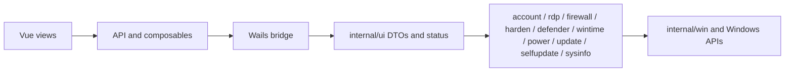

[English](README.md) | [繁體中文](README.zh-TW.md) | [简体中文](README.zh-CN.md)

# WinToolBox

A local Windows administration toolbox built with Go, [Wails v2](https://wails.io), Vue 3 and Element Plus.
Version: v1.0.0

## Languages and documentation

English is the default/fallback and primary documentation language. English, Traditional Chinese and Simplified Chinese are supported. First launch follows the user's Windows display language: Taiwan/Hong Kong/Macao select Traditional Chinese, Mainland China/Singapore select Simplified Chinese, and other languages select English. A sidebar selector overrides detection and remembers the choice.

WinToolBox runs directly as an EXE. If WebView2 is missing, its automatic installation window follows the Windows display language before the app starts. There is no separate application installation wizard. OS command output, device/user names and release notes retain their source language.

- [English documentation](docs/README.md)
- [繁體中文文件](docs/zh-TW/README.md)
- [简体中文文档](docs/zh-CN/README.md)
- [Download and first launch](docs/00-download.md)
- [Language selection](docs/localization.md)
- [Windows hardening guide](docs/90-hardening-guide.md)
- [Development and acceptance](docs/development.md)

## Features

| Module | Capabilities |
|---|---|
| Overview | Hostname, Windows/build, activation, resolution, IPs, volumes and hardware |
| Local accounts | Passwords, enabled state, administrator rights, Guest, automatic logon, lockout and password policies |
| Remote Desktop | Service, port with firewall synchronization, NLA and mstsc history cleanup |
| Firewall | Profiles, ping blocking, high-risk ports and inbound TCP allow rules |
| Security hardening | SMBv1, WinRM and anonymous enumeration |
| Antivirus | Disable/enable Defender real-time protection with fallback and verification |
| Time synchronization | Time zones, NTP presets, synchronization and NTP testing |
| Power | Lock, delayed restart/shutdown and schedule cancellation |
| Windows Update | Disable and restore configuration saved before disabling |
| App update | GitHub releases, SHA256 verification, download progress/cancellation and installation |

## Supported systems

Windows 10 / 11 and Windows Server 2016 / 2019 / 2022 / 2025, amd64. Administrator privileges are required. Missing WebView2 is downloaded automatically; internet access is required for this step.

## Build and run

Dependencies: Go 1.27+, Node.js 22.13+ and WebView2 Runtime.

```powershell
.\scripts\build.ps1
```

Development with the Wails CLI:

```powershell
wails dev
```

Run `WinToolBox.exe` and accept UAC elevation, or select **Run as administrator**. Production artifacts are written to `artifacts/releases/`.

## Download and verification

Download from [GitHub Releases](https://github.com/lucaswren/wintoolbox/releases/latest). The executable currently has no Authenticode signature, so the browser or SmartScreen may block it. Confirm its source and compare the release SHA256 before selecting **Keep**, or **More info → Run anyway**.

```powershell
Get-FileHash .\WinToolBox-v1.0.0-windows-amd64.exe -Algorithm SHA256
```

## Architecture



`frontend/src/views/` matches the ten sidebar modules. `frontend/src/i18n/` holds translation catalogs. `internal/locale/` detects Windows language and translates native setup prompts. English guides live in `docs/`, with corresponding Chinese guides in `docs/zh-CN/` and `docs/zh-TW/` and shared images.

## Checks

```powershell
go run ./scripts/genbindings
cd frontend
npm ci
npm run check
npm run build
cd ..
go test ./...
go vet ./...
```

## v1.0.0 release notes

- Local account, RDP, firewall, hardening, Defender, time, power and Windows Update management.
- Backups become valid only after all required writes succeed; validate before restoration and verify after operations.
- Module refresh, coalesced probes and resource locks reduce duplicate work.
- App updates verify SHA256, support progress/cancellation and retain rollback files/logs.
- Improved account/log/small-window layouts, bridge type checks, regression tests and Windows CI.
- Updates use `lucaswren/wintoolbox`, with SHA256 release attachments.

The version was reset to v1.0.0. Users running v1.2.0 must install this version manually; it is not recognized as a newer version.

[Product review and license recommendations](docs/product-review-2026-10-11.md)
