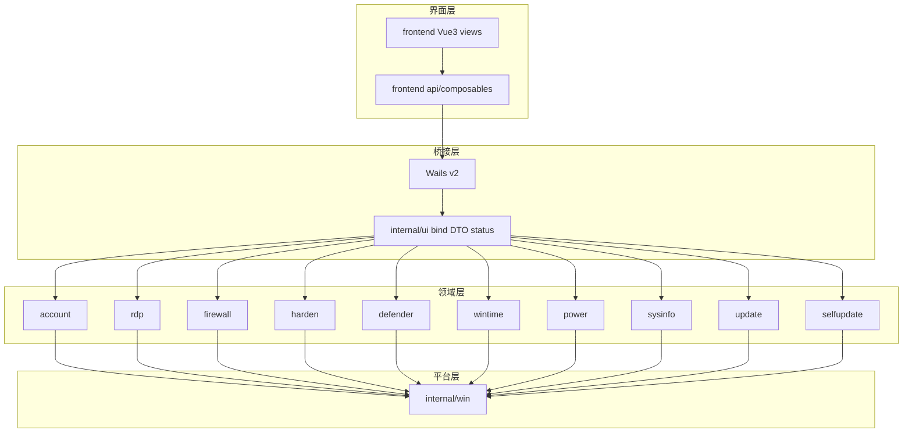

# WinToolbox

Windows 本地运维工具箱：Go + [Wails v2](https://wails.io) + Vue3 + Element Plus。
版本：v1.0.0

## 文档

各操作文档**第一步均为下载本软件**：https://github.com/lucaswren/wintoolbox/releases/latest
浏览器拦截时请点 **保留 / 保持**；详见 [00 · 下载](./docs/00-download.md)。

- [文档首页](./docs/README.md)
- [00 · 下载](./docs/00-download.md)
- [90 · 系统加固指南](./docs/90-hardening-guide.md)
- [02 · 本地账户](./docs/02-local-account.md)
- [03 · 远程桌面](./docs/03-remote-desktop.md)
- [04 · 防火墙](./docs/04-firewall.md)
- [05 · 安全加固](./docs/05-security-harden.md)
- [09 · 系统更新](./docs/09-windows-update.md)
- [全部功能文档](./docs/README.md)

## v1.0.0 发布说明

- 包含本地账户、远程桌面、防火墙、安全加固、Defender、时间、电源及 Windows Update 管理
- 配置备份仅在全部写入成功后标记有效；恢复前校验备份，操作后复查状态
- 按模块刷新状态，合并并发查询，为系统写操作增加互斥，减少重复请求和界面等待
- 软件更新支持 SHA256 校验、下载进度及取消，安装失败可回退并保留日志
- 优化账户页、操作日志和小窗口布局，增加桥接类型检查、回归测试和 Windows CI
- 更新请求统一使用 `lucaswren/wintoolbox`，发布附件提供 SHA256 校验文件

本次将版本号重新设为 v1.0.0。已安装 v1.2.0 的用户需手动下载并安装，此版本不会被识别为更高版本。

## 功能

| 模块     | 能力 |
|----------|------|
| 本机概览 | 主机名、系统+Build、激活、分辨率、IP、磁盘与硬件信息 |
| 本地账户 | 改密码、启用/禁用、管理员；来宾/自动登录；锁定与密码策略 |
| 远程桌面 | 开关、改端口并同步防火墙、强制 NLA；清理 mstsc 连接记录 |
| 防火墙   | 一键开/关配置文件；禁 ping；高危端口预设；TCP 放行规则 |
| 安全加固 | SMBv1、WinRM、匿名枚举一键加固 |
| 防病毒   | 关闭/恢复 Defender 实时防护（含策略回退与复查） |
| 时间同步 | 时区、NTP 预设、立即同步、测试 NTP |
| 电源     | 锁定、延时重启/关机、取消计划 |
| 系统更新 | 关闭/恢复 Windows Update（按关闭前的配置备份还原，非云主机磁盘快照） |
| 软件更新 | GitHub Release 检测、SHA256 校验下载与安装 |

## 支持系统

Windows 10 / 11，Windows Server 2016 / 2019 / 2022 / 2025

需管理员权限。界面基于 WebView2；若未安装会自动联网下载并显示安装进度。

## 架构



## 项目结构

```
wintoolbox/
├── version.json
├── docs/                   # 操作文档与标注配图
├── scripts/build.ps1
├── frontend/src/views/     # 与侧栏一一对应
└── internal/               # account/rdp/firewall/harden/...
```

### 前端 views 对照

| 侧栏     | 视图           | 后端包     |
|----------|----------------|------------|
| 本机概览 | OverviewView   | sysinfo    |
| 本地账户 | AccountView    | account    |
| 远程桌面 | RdpView        | rdp        |
| 防火墙   | FirewallView   | firewall   |
| 安全加固 | HardenView     | harden     |
| 防病毒   | DefenderView   | defender   |
| 时间同步 | TimeView       | wintime    |
| 电源     | PowerView      | power      |
| 系统更新 | UpdateView     | update     |
| 软件更新 | SelfUpdateView | selfupdate |

## 构建

**依赖**：Go 1.27+、Node.js 22+、WebView2 Runtime

```powershell
.\scripts\build.ps1
```

开发模式（需安装 Wails CLI）：

```powershell
wails dev
```

## 运行

双击 `WinToolbox.exe` 按 UAC 提权，或以管理员身份运行。

## 下载与 SmartScreen

从 GitHub Release 下载的安装包**当前未做 Authenticode 代码签名**。Windows 可能提示 SmartScreen 拦截——多为未签名 + 新文件无下载信誉，不代表文件一定有害。

若确认来自本仓库 [Releases](https://github.com/lucaswren/wintoolbox/releases)：

1. **更多信息** → **仍要运行**
2. 用 Release / `*.sha256` 中的哈希校验后再运行

```powershell
Get-FileHash .\WinToolbox-v1.0.0-windows-amd64.exe -Algorithm SHA256
```

## 技术栈

Go · Wails v2 · Vue3 · Element Plus · Windows API / netsh / w32tm / tzutil / slmgr / WebView2

## 开发检查

```powershell
go run ./scripts/genbindings
cd frontend
npm ci
npm run check
npm run build
cd ..
go test ./...
go vet ./...
```

生产构建产物位于 `artifacts/releases/`，开发约定和故障验收见 [开发规范](docs/development.md)。
