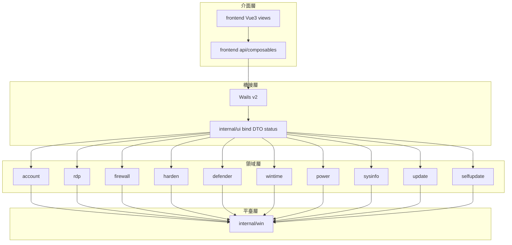

[English](README.md) · [繁體中文](README.zh-Hant.md) · [简体中文](README.zh-Hans.md)

# WinToolBox

WinToolBox 是 Windows 本機管理工具箱，可檢視系統資訊，管理本機帳戶、遠端桌面、防火牆規則、Microsoft Defender、時間同步、電源及更新。使用 Go、Wails、Vue 與 Element Plus 開發。

版本：v1.0.1

## 文件

從 [GitHub Releases](https://github.com/lucaswren/wintoolbox/releases/latest) 下載。執行前請確認來源並核對 SHA256；下載與啟動說明請見 [00 · 下載](./docs/zh-Hant/00-download.md)。

- [文件首頁](./docs/zh-Hant/README.md)
- [00 · 下載](./docs/zh-Hant/00-download.md)
- [90 · 系統加固指南](./docs/zh-Hant/90-hardening-guide.md)
- [02 · 本地帳戶](./docs/zh-Hant/02-local-account.md)
- [03 · 遠端桌面](./docs/zh-Hant/03-remote-desktop.md)
- [04 · 防火牆](./docs/zh-Hant/04-firewall.md)
- [05 · 安全加固](./docs/zh-Hant/05-security-harden.md)
- [09 · 系統更新](./docs/zh-Hant/09-windows-update.md)
- [全部功能文件](./docs/zh-Hant/README.md)

## v1.0.0 發布說明

- 包含本地帳戶、遠端桌面、防火牆、安全加固、Defender、時間、電源及 Windows Update 管理
- 設定備份僅在全部寫入成功後標記有效；恢復前校驗備份，操作後復查狀態
- 按模塊刷新狀態，合並並發查詢，為系統寫操作增加互斥，減少重復請求和介面等待
- 軟體更新支持 SHA256 校驗、下載進度及取消，安裝失敗可回退並保留日志
- 優化帳戶頁、操作日志和小窗口布局，增加橋接類型檢查、回歸測試和 Windows CI
- 更新請求統一使用 `lucaswren/wintoolbox`，發布附件提供 SHA256 校驗檔案

本次將版本號重新設為 v1.0.0。已安裝 v1.2.0 的使用者需手動下載並安裝，此版本不會被識別為更高版本。

## 功能

| 模塊     | 能力 |
|----------|------|
| 本機概覽 | 主機名、系統+Build、激活、分辨率、IP、磁盤與硬體資訊 |
| 本地帳戶 | 改密碼、啟用/停用、系統管理員；來賓/自動登錄；鎖定與密碼策略 |
| 遠端桌面 | 開關、改連接埠並同步防火牆、強制 NLA；清理 mstsc 連線記錄 |
| 防火牆   | 一鍵開/關設定檔案；禁 ping；高危連接埠預設；TCP 放行規則 |
| 安全加固 | SMBv1、WinRM、匿名枚舉一鍵加固 |
| 防病毒   | 關閉/恢復 Defender 即時防護（含策略回退與復查） |
| 時間同步 | 時區、NTP 預設、立即同步、測試 NTP |
| 電源     | 鎖定、延時重新啟動/關機、取消計劃 |
| 系統更新 | 關閉/恢復 Windows Update（按關閉前的設定備份還原，非雲主機磁盤快照） |
| 軟體更新 | GitHub Release 檢測、SHA256 校驗下載與安裝 |

## 支持系統

Windows 10 / 11，Windows Server 2016 / 2019 / 2022 / 2025

需系統管理員權限。介面基于 WebView2；若未安裝會自動聯網下載並顯示安裝進度。

## 架構



## 項目結構

```
wintoolbox/
├── version.json
├── docs/                   # 操作文件與標注配圖
├── scripts/build.ps1
├── frontend/src/views/     # 與側欄一一對應
└── internal/               # account/rdp/firewall/harden/...
```

### 前端 views 對照

| 側欄     | 視圖           | 後端包     |
|----------|----------------|------------|
| 本機概覽 | OverviewView   | sysinfo    |
| 本地帳戶 | AccountView    | account    |
| 遠端桌面 | RdpView        | rdp        |
| 防火牆   | FirewallView   | firewall   |
| 安全加固 | HardenView     | harden     |
| 防病毒   | DefenderView   | defender   |
| 時間同步 | TimeView       | wintime    |
| 電源     | PowerView      | power      |
| 系統更新 | UpdateView     | update     |
| 軟體更新 | SelfUpdateView | selfupdate |

## 構建

**依賴**：Go 1.27+、Node.js 22+、WebView2 Runtime

```powershell
.\scripts\build.ps1
```

開發模式（需安裝 Wails CLI）：

```powershell
wails dev
```

## 執行

雙擊 `WinToolBox.exe` 按 UAC 提權，或以系統管理員身份執行。

## 下載與 SmartScreen

從 GitHub Release 下載的安裝包**當前未做 Authenticode 代碼簽名**。Windows 可能提示 SmartScreen 攔截——多為未簽名 + 新檔案無下載信譽，不代表檔案一定有害。

若確認來自本倉庫 [Releases](https://github.com/lucaswren/wintoolbox/releases)：

1. **更多資訊** → **仍要執行**
2. 用 Release / `*.sha256` 中的哈希校驗後再執行

```powershell
Get-FileHash .\WinToolBox-v1.0.0-windows-amd64.exe -Algorithm SHA256
```

## 技術棧

Go · Wails v2 · Vue3 · Element Plus · Windows API / netsh / w32tm / tzutil / slmgr / WebView2

## 開發檢查

```powershell
go run ./scripts/genbindings
cd frontend
npm ci
npm run check
npm run build
cd ..
go test ./...
go vet ./...
```

生產構建產物位于 `artifacts/releases/`，開發約定和故障驗收見 [開發規范](docs/zh-Hant/development.md)。

## 多語言

支援英語、繁體中文和簡體中文，以英語為預設及回退語言。首次啟動根據 Windows 顯示語言自動選擇；側欄可手動切換並儲存偏好。軟體直接執行 EXE，缺少 WebView2 時的自動安裝視窗也根據系統語言顯示。詳見[語言選擇](docs/zh-Hant/localization.md)。

[軟體審查與授權建議](docs/zh-Hant/product-review-2026-10-11.md)

## 開源授權

WinToolBox 原始碼及文件採用 [Apache-2.0](LICENSE)，專案聲明請見 [NOTICE](NOTICE)。第三方元件保留各自的授權條款。

[全功能與介面審查](docs/zh-Hant/operation-audit-2026-10-12.md)
