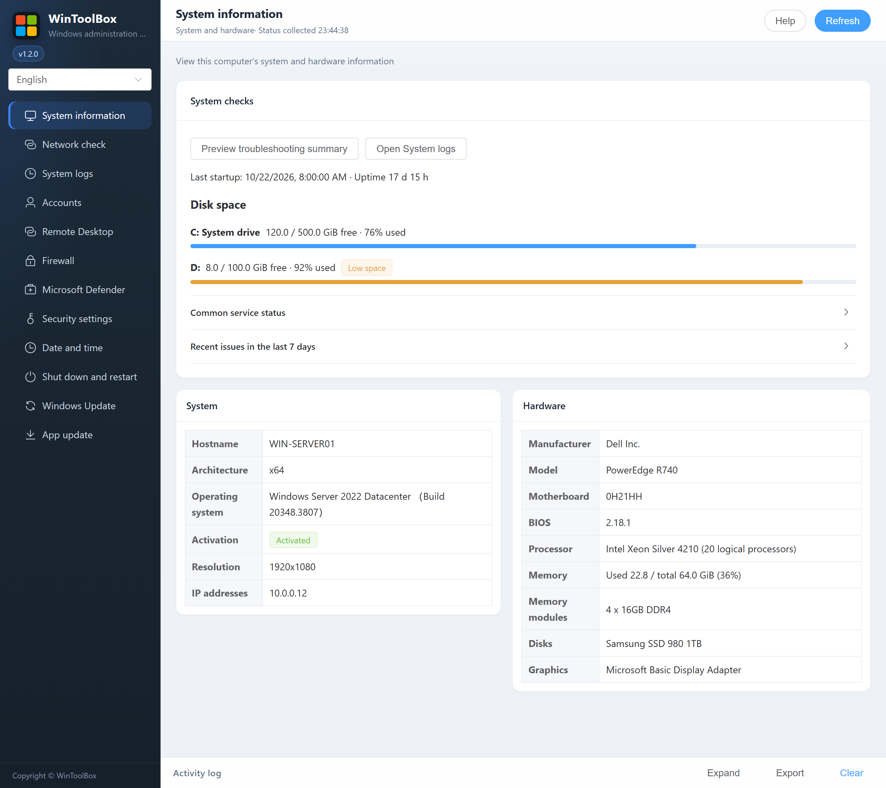

[English](01-overview.md) · [繁體中文](zh-Hant/01-overview.md) · [简体中文](zh-Hans/01-overview.md)

# 01 · System information

Open **System information** to view the hostname, architecture, Windows edition/build, activation status, display resolution, IP addresses and volumes.

The hardware card shows manufacturer, model, motherboard, BIOS, CPU and logical processors, memory usage/modules, physical disks and graphics adapters. Hardware details load separately from the initial status snapshot.

Select **Refresh** to collect new information. **Unknown**, **Checking…**, **Read failed** or **Query timed out** are diagnostic states, not evidence of a disabled feature. Windows and device-supplied names retain their original language.

## System checks

- **Disk space** shows free capacity for local fixed drives and highlights the system drive. A warning appears below 2 GiB free or below 10% free.
- **Last startup** shows the Windows startup time and how long the system had been running when checked.
- **Common service status** shows read-only status. Some services run only when needed.
- **Recent issues in the last 7 days** shows the latest matching event for each of IDs 41, 6008 and 1001. Open **System logs** for details.
- **Preview troubleshooting summary** combines the Windows version, disk space and recent events with the last [network check](12-network-check.md) run in this window. The copied text omits hostnames, usernames, target addresses and IPs.

Start by [downloading WinToolBox](00-download.md) and running it as administrator.

[Operation feedback and audit](operation-audit-2026-10-12.md)
