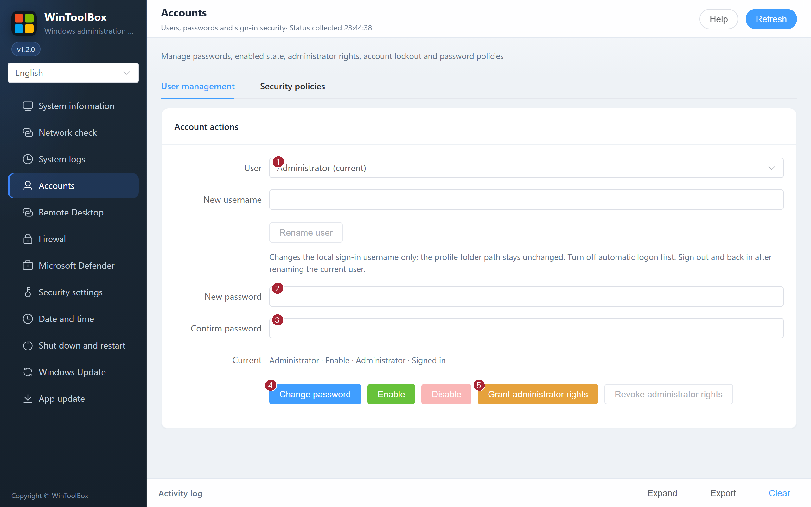
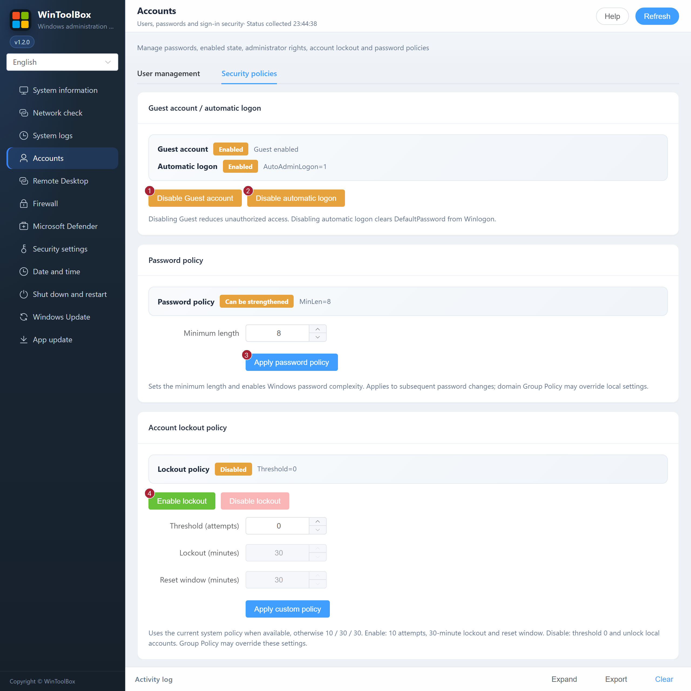

[English](02-local-account.md) · [繁體中文](zh-Hant/02-local-account.md) · [简体中文](zh-Hans/02-local-account.md)

# 02 · Accounts

Rename local users, manage their passwords, enabled state and administrator membership, or open **Security policies** to manage Guest, automatic logon, password complexity and account lockout. Domain accounts remain governed by domain policy.

## User management

1. Select a user under **User management**.
2. Enter the same new password twice and select **Change password**; confirm the operation.
3. Use **Enable / Disable**, **Grant administrator rights** or **Revoke administrator rights** as needed. The backend prevents disabling the current user or removing their administrator rights.
4. Verify that the new credentials work.

To rename an account, enter its new name under **User management** and select **Rename user**. Disable automatic logon and refresh first. Choose a name of up to 20 characters that is not in use by a local user or group. The account keeps its SID, password, permissions and profile folder. After renaming the signed-in account, sign out and sign back in. Update any services, scheduled tasks or saved connections that refer to the old name.

## Security policies

| Action | Effect |
|---|---|
| Disable Guest account | Disables the local Guest account |
| Disable automatic logon | Disables AutoAdminLogon and clears Winlogon DefaultPassword |
| Apply password policy | Sets the minimum length and enables complexity |
| Enable lockout | Sets 10 attempts, a 30-minute lockout and a 30-minute reset window |
| Disable lockout | Sets the threshold to 0 and unlocks locked local accounts |
| Apply custom policy | Applies your threshold, lockout duration and reset window |

Current system values are used when available; otherwise lockout fields start at 10 / 30 / 30. When a policy is unknown, editable values represent the target rather than confirmed current settings. Group Policy can override local changes. Use strong passwords (the existing guidance recommends at least 12 characters, or 14 for servers, with mixed character types).

Related: [Hardening guide](90-hardening-guide.md) · [Remote Desktop](03-remote-desktop.md)

Start by [downloading WinToolBox](00-download.md) and running it as administrator.

[Operation feedback and audit](operation-audit-2026-10-12.md)
