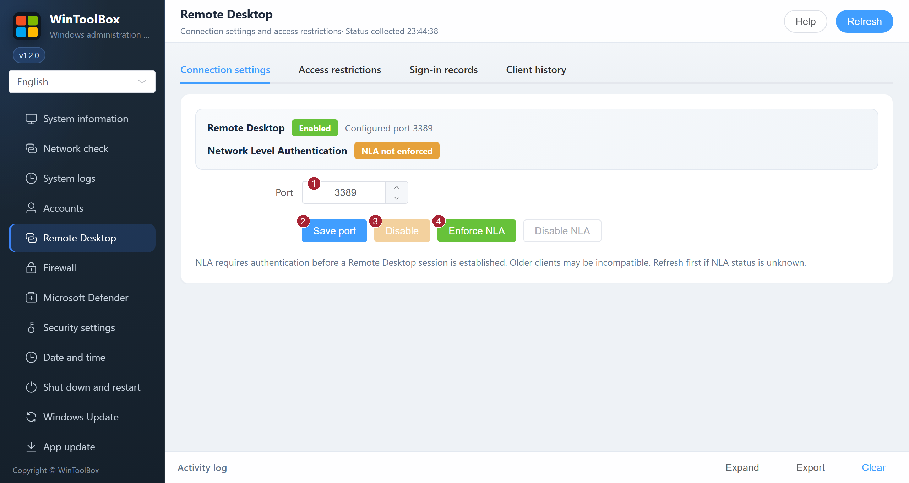

[English](03-remote-desktop.md) · [繁體中文](zh-Hant/03-remote-desktop.md) · [简体中文](zh-Hans/03-remote-desktop.md)

# 03 · Remote Desktop

Manage the Remote Desktop service, listening port, Network Level Authentication (NLA) and server sign-in records.

If you only want to check whether Remote Desktop is enabled, open **Remote Desktop → Connection settings** and read the status. If you already connect successfully, keep your current port unless you have a specific reason to change it. Before making a change on a remote server, make sure you can open the provider’s console.

1. If Remote Desktop is off and you need it, select **Enable** from the computer's local or provider console.
2. To change the port, first allow the new port in any cloud firewall. In **Connection settings**, enter a port from 1024 to 65535 and select **Save port**. The Remote Desktop service restarts after about ten seconds and disconnects active sessions.
3. Reconnect using `IP:new-port` within five minutes. Select the banner's confirmation button from the new Remote Desktop session to keep the change. If the new connection fails or you do not confirm in time, the tool restores the previous settings.
4. To require sign-in before the desktop session opens, select **Enforce NLA** after the previous change is complete. Reconnect and confirm again. Older clients may be unable to connect with NLA enforced.

The RDP page also provides IPv4/IPv6 source allowlists, listener checks tied to the TermService process, candidate rules from ActiveStore, and server logon/disconnection events. Allowlist changes restrict existing applicable allow rules; conflicting managed or broad rules prevent changes. NLA changes and enabling all firewall profiles use the same protection. Destructive generic network operations require the local console; pending transactions and confirmed allowlists restrict ordinary network writes.

Keep VPS console access available. Recovery covers saved host settings only, not cloud security groups, NAT, credentials or OS failures. Domain controllers and unknown/noninteractive sessions are refused; managed RDP policies must be changed by their administrator. Target systems are Windows Server 2016–2025 with Desktop Experience, PowerShell 5.1, NetSecurity and Task Scheduler. Multi-version VPS acceptance remains required. See the [detailed protection, diagnostics and console recovery guide (Simplified Chinese)](zh-Hans/03-remote-desktop.md#vps-防失联保护).

Changing ports alone does not replace access controls or NLA. Confirm that the old port is no longer exposed where appropriate.

**Access restrictions** shows the allowlist and local listener status. Raw rules and output are collapsed under **Diagnostics**. **Sign-in records** supports a 1–90 day range, source summaries, failure reasons, repeated-failure hints, search, event details/XML and full JSON export. Network authentication failures are distinguished from confirmed remote interactive logons; incomplete channel coverage is reported. **Clear results** resets this view without deleting Windows event logs. **Client history** retains search, type filters, single-record deletion, clearing a selected type and clearing all records, including saved credentials and bitmap cache. Records load when this tab is opened; cleanup does not change the Remote Desktop service or port.

## Protected settings and recovery

- In **Connection settings**, **Disable NLA** allows older clients without NLA support to reach the Windows sign-in screen. Use it only when necessary. It also requires reconnecting and confirming within five minutes.
- In **Access restrictions**, enter one IPv4 address, IPv6 address or CIDR range per line (up to 64) and select **Save access restrictions**. Use the source address the server sees. An empty list is rejected. Expand **Diagnostics** to inspect the listener and effective rules.
- To undo a pending change, select **Restore previous configuration** in the top banner. If the connection is lost, wait for automatic recovery and use the provider's console if needed.

## Client history and connection checks

Select **Check connection status** under **Access restrictions** to refresh the local listener and rule status. For saved client connections, open **Client history** and select **Refresh list** after changes. Search or filter by type, then choose **Delete** for one entry, **Clear selected type** for the selected type, or **Clear all history** for every type. Clearing saved credentials can require re-entering them next time.

Start by [downloading WinToolBox](00-download.md) and running it as administrator.

[Operation feedback and audit](operation-audit-2026-10-12.md)
