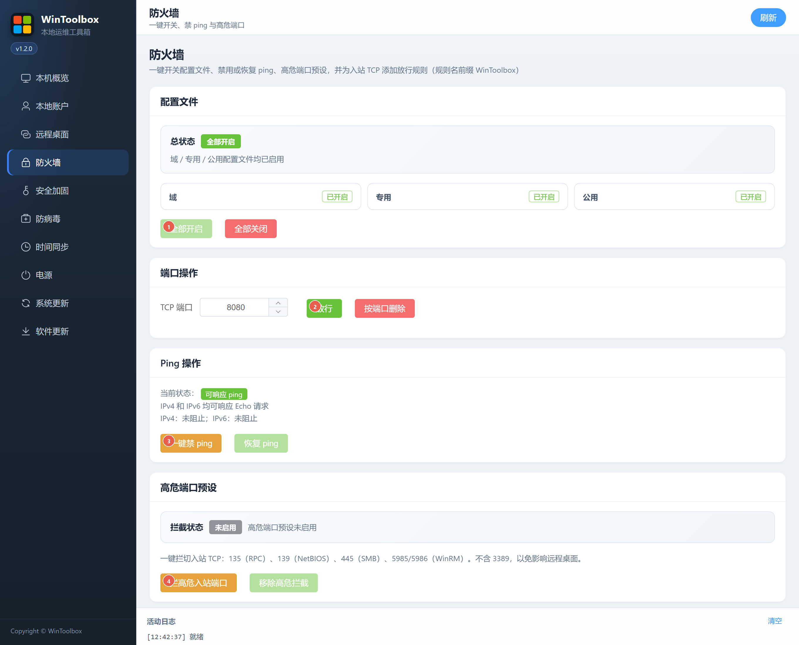

[English](04-firewall.md) | [繁體中文](zh-Hant/04-firewall.md) | [简体中文](zh-Hans/04-firewall.md)

# 04 · Firewall

Control Domain / Private / Public profiles, inbound TCP allow rules, ICMP Echo (ping) and a high-risk port preset.

| Action | Effect |
|---|---|
| All enabled / All disabled | Toggles all three firewall profiles |
| Allow | Creates an inbound TCP allow rule for the entered port |
| Delete by port | Removes the corresponding WinToolBox allow rule |
| Delete all allow rules | Removes `WinToolbox-Allow-*` rules |
| Block ping / Restore ping | Adds/removes WinToolBox inbound IPv4/IPv6 Echo blocks |
| Block high-risk inbound ports | Blocks TCP 135, 139, 445, 5985 and 5986 |
| Remove high-risk blocks | Removes the blocks created by WinToolBox |

The high-risk preset excludes 3389 to preserve Remote Desktop access. Blocking SMB/WinRM ports can interrupt file sharing, remote PowerShell or automation. Disabling all profiles removes network filtering protection.

Profile and ping status may be partial or unknown. **No WinToolBox block detected** does not guarantee ping responses: other firewall rules and the network also affect them. Refresh unknown state before making changes. Cleanup of allow rules leaves Remote Desktop and ping rules unchanged.

Start by [downloading WinToolBox](00-download.md) and running it as administrator.

Screenshots show the earlier Simplified Chinese interface; the labels above describe the English interface. Download prompts are illustrations.
