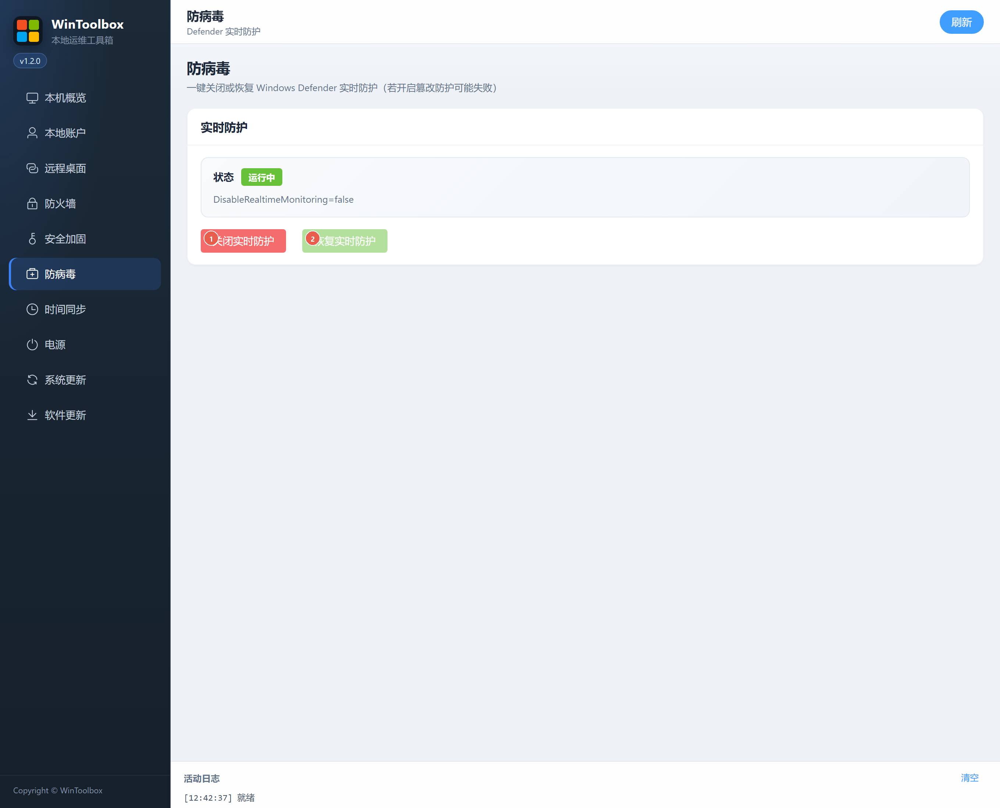

[English](06-defender.md) | [繁體中文](zh-TW/06-defender.md) | [简体中文](zh-CN/06-defender.md)

# 06 · Antivirus

Use **Disable real-time protection** or **Enable real-time protection** to control Windows Defender scanning.

Disabling real-time protection temporarily removes real-time scanning protection. Tamper Protection or Group Policy can reject or override the change; inspect the returned error and refresh the state. A submitted change does not guarantee it took effect.

**Enable real-time protection** explicitly turns protection on; it does not restore a previously disabled state. Configuration backups are marked valid only after their required fields have been written successfully.

Start by [downloading WinToolBox](00-download.md) and running it as administrator.

Screenshots show the earlier Simplified Chinese interface; the labels above describe the English interface. Download prompts are illustrations.
