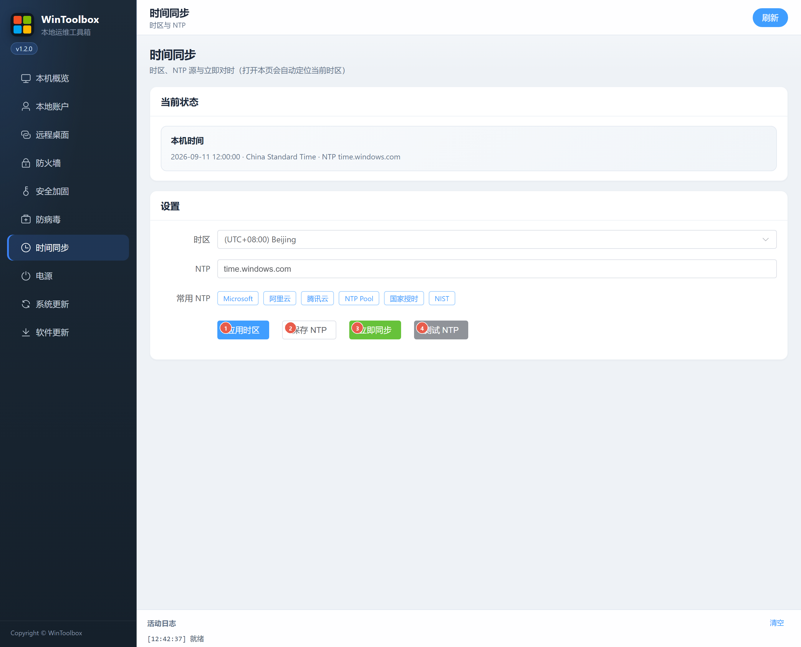

[English](07-time-sync.md) | [繁體中文](zh-TW/07-time-sync.md) | [简体中文](zh-CN/07-time-sync.md)

# 07 · Time synchronization

Open **Time synchronization** to view local time and NTP status. The current Windows time zone is selected automatically.

1. Select a time zone and choose **Apply time zone**.
2. Choose an NTP preset or enter a server, then select **Save NTP**.
3. Select **Synchronize now** to request network time synchronization.
4. Use **Test NTP** to inspect the chosen server's response.

An empty NTP server is rejected. Network or Windows Time service errors appear in the activity log. If the status query fails or times out, refresh before proceeding. Windows-provided time zone names use the Windows language.

Start by [downloading WinToolBox](00-download.md) and running it as administrator.

Screenshots show the earlier Simplified Chinese interface; the labels above describe the English interface. Download prompts are illustrations.
