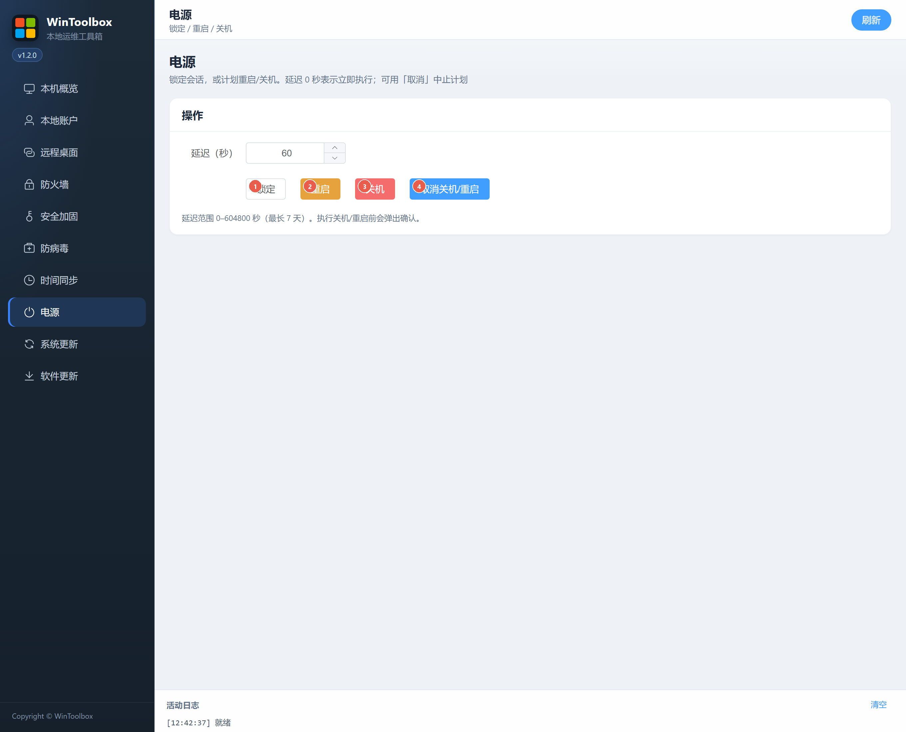

[English](08-power.md) · [繁體中文](zh-Hant/08-power.md) · [简体中文](zh-Hans/08-power.md)

# 08 · Power

Use **Lock** to lock the current session, or **Restart / Shut down** to schedule a power action.

1. Set **Delay (seconds)** from 0–604800 (up to 7 days). Zero means immediately.
2. Select **Restart** or **Shut down** and read the confirmation.
3. Save your work before confirming: these actions forcibly close applications.
4. Use **Cancel shutdown/restart** to cancel a pending schedule.

Start by [downloading WinToolBox](00-download.md) and running it as administrator.

Screenshots show the earlier Simplified Chinese interface; the labels above describe the English interface. Download prompts are illustrations.

[Operation feedback and audit](operation-audit-2026-10-12.md)
