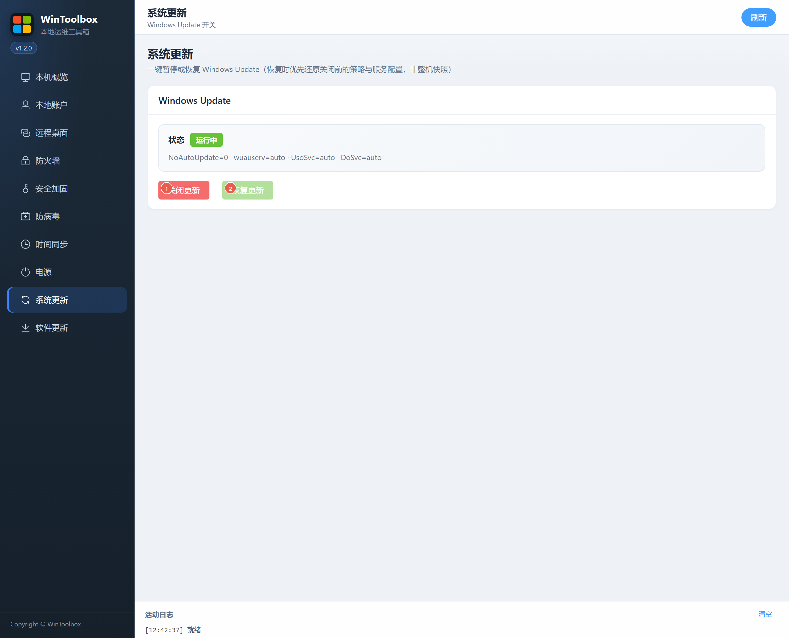

[English](09-windows-update.md) | [繁體中文](zh-Hant/09-windows-update.md) | [简体中文](zh-Hans/09-windows-update.md)

# 09 · Windows Update

**Disable updates** pauses Windows Update by applying local policies and service/task configuration. Security patches will no longer arrive automatically; use this only for an appropriate maintenance window.

**Restore previous configuration** restores the settings saved before disabling. If the original configuration was disabled, it remains disabled. When no backup exists, recommended enabled settings are used. This is a configuration backup, not a full machine or cloud disk snapshot.

All required backup writes must succeed before the backup is marked valid. Corrupt backups are rejected before restoration. Refresh and verify the resulting status after either action; Group Policy can override local settings.

Start by [downloading WinToolBox](00-download.md) and running it as administrator.

Screenshots show the earlier Simplified Chinese interface; the labels above describe the English interface. Download prompts are illustrations.
