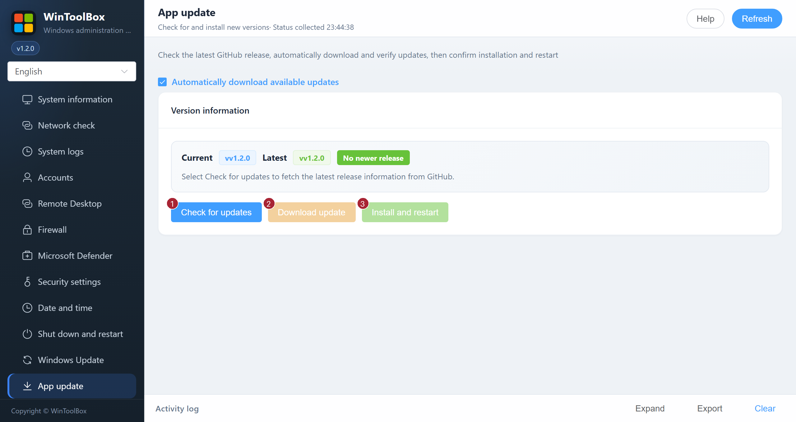

[English](10-app-update.md) · [繁體中文](zh-Hant/10-app-update.md) · [简体中文](zh-Hans/10-app-update.md)

# 10 · App update

Update WinToolBox itself from the [repository releases](https://github.com/lucaswren/wintoolbox/releases).

1. Open **App update** and select **Check for updates**.
2. If a new version exists, select **Download update** and wait for SHA256 verification. Automatic download is enabled by default and can be disabled on this page; the preference is saved locally.
3. Select **Install and restart**, then confirm. Installation replaces the application and restarts it.

The page shows current/latest versions, release notes, package name, verification status, local path, downloaded amount and transfer speed. **Cancel download** stops an active download. GitHub connectivity is required.

The updater verifies the file before and after copying, retains the previous executable and attempts rollback if replacement/startup fails. Its limited startup check does not prove that the UI is fully ready. Diagnostic logs are stored under the user cache `WinToolbox/updates/last-install.log`.

If you have any earlier 1.2.0 build, manually download and replace the executable with the current 1.2.0 release. Automatic update requires a higher version number.

Start by [downloading WinToolBox](00-download.md) and running it as administrator.

[Operation feedback and audit](operation-audit-2026-10-12.md)
