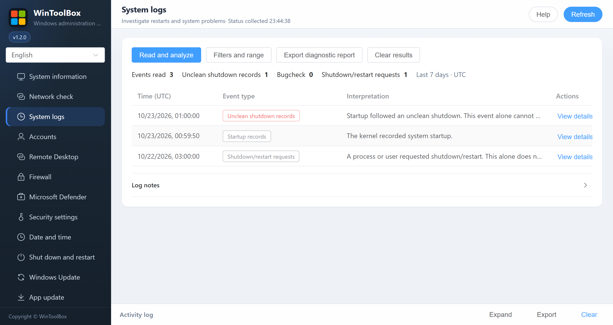

[English](11-system-logs.md) · [繁體中文](zh-Hant/11-system-logs.md) · [简体中文](zh-Hans/11-system-logs.md)

# 11 · System logs

Open **System logs** and select **Read and analyze** to see recent startup, shutdown and error events. Use **Filters and range** to change the time range or record limit, and **View details** to see what an event means. **Export diagnostic report** exports the entire loaded report as JSON, including host/account details where present; review it before sharing.

The page covers startup, shutdown requests and sequences, unclean shutdowns, bugchecks, hardware/storage reports, dump failures, service failures, updates, log clearing and clock changes. Classification matches both provider and ID. Counts refer to events, not the number of reboots; related records within ten minutes are clues rather than established causes. Reads are bounded, and disabled logs, permission failures and truncation are reported. Audit and system settings are not changed.

Event 41 alone does not establish power loss or another specific cause. Check stop codes and dumps, then correlate monitoring and VPS provider/host records. See Microsoft's [unexpected reboot investigation](https://learn.microsoft.com/en-us/troubleshoot/windows-server/performance/troubleshoot-unexpected-reboots-system-event-logs) and [Event 41 limitations](https://learn.microsoft.com/en-us/troubleshoot/windows-client/performance/event-id-41-restart).

Read the [detailed guide in Simplified Chinese](zh-Hans/11-system-logs.md) for event IDs, limitations and investigation steps.

**Clear results** resets displayed records, statistics, details, filters and errors. It does not delete Windows event logs. It is disabled during a read; reading again reloads retained history.

The default view shows actions, compact counts and key records. Open **Filters and range** for collection settings, categories and search. **Log notes** contains collection metadata and full explanations. Event details keep original text, fields, XML and nearby evidence collapsed until opened. Brief read-failure and incomplete-log notices remain visible.
