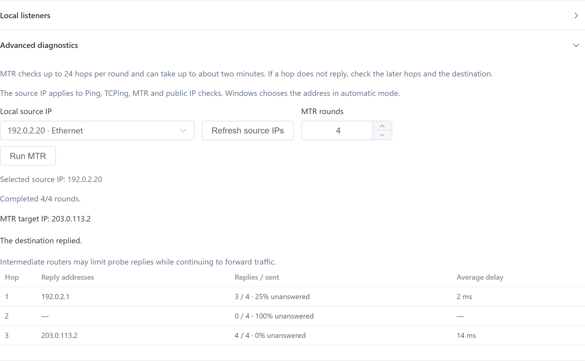

[English](12-network-check.md) · [繁體中文](zh-Hant/12-network-check.md) · [简体中文](zh-Hans/12-network-check.md)

# 12 · Network check

Enter a domain name or IP address and select **Start check**.

- **DNS lookup** shows the addresses Windows provides for a connection. Entering an IP directly skips lookup. To test a specific result from the list, enter that IP as the target.
- **Ping** sends four requests and shows replies, unanswered percentage and average delay.
- **TCPing** appears when you enter a TCP port such as `443` for HTTPS. Choose 1–10 attempts, then select **Start check**. The result shows the success rate and shortest, average and longest connection times for successful attempts. A successful TCP connection confirms that the port accepts connections. Sign-in and application behavior can be checked separately.

## Public egress IP

Select **Check public IPs**. The app sends direct HTTPS requests to ipify at `api.ipify.org` for IPv4 and `api6.ipify.org` for IPv6. The two rows show the local address used for each connection and the public address seen by the endpoint. An unavailable result means this lookup did not obtain an address on that family. Try again after checking connectivity to the endpoint.

For multiple network adapters or addresses, expand **Advanced diagnostics**, select a **Local source IP**, and run the public IP check again. The selected source applies to Ping, TCPing, MTR and public IP checks. Select **Automatic** to let Windows choose. A manual source tests only the matching IP family in the public IP table. The target for Ping, TCPing or MTR must also have an address in that family. **Refresh source IPs** rereads the address list.

If two local addresses reach the endpoint through the same NAT, they can show the same public IP. The result describes the route to the lookup endpoint. Cloud NAT and VPN routing can make other connections use a different public IP.

## MTR and local listeners

In **Advanced diagnostics**, set **MTR rounds** to 1–10 and select **Run MTR**. Each round checks up to 24 hops. A long run can take about two minutes. **Stop MTR** ends the run after the current probe and keeps the results collected so far. If an intermediate hop does not answer but later hops do, it may be limiting probe responses.

For a VPS, enter a port and open **Local listeners → Check local port** on the VPS. To verify outside access, run TCPing from another computer against the VPS public IP. Cloud security groups and local firewalls can affect that connection.
