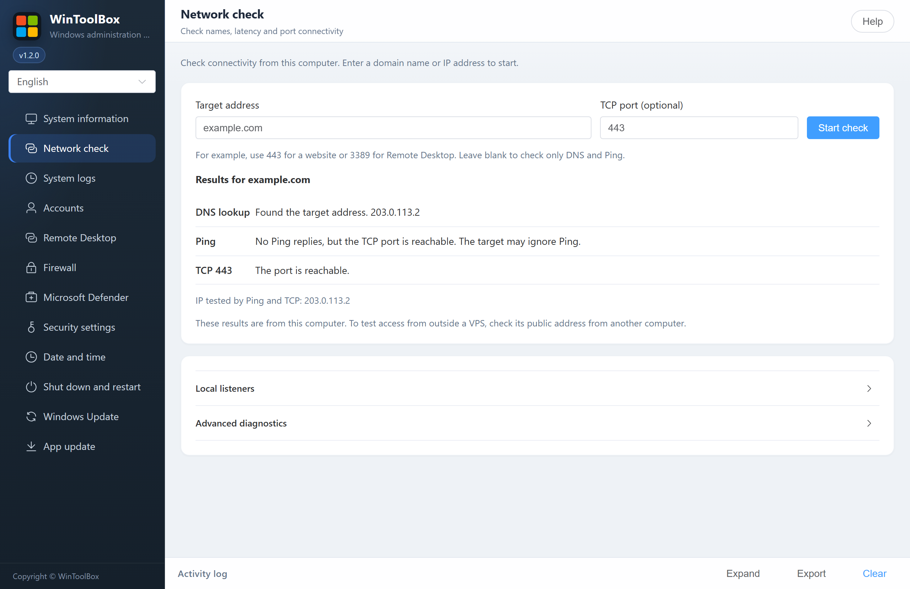

[English](12-network-check.md) · [繁體中文](zh-Hant/12-network-check.md) · [简体中文](zh-Hans/12-network-check.md)

# 12 · Network check

Open **Network check**. Enter a domain name or IP address such as `example.com`, then select **Start check**. To check a specific service, also enter its TCP port, such as `443` for a website or `3389` for Remote Desktop.

- **DNS lookup** shows the addresses that the local Windows resolver provides for a connection. Windows can return a subset of published A and AAAA records, depending on its network configuration. If you enter an IP address directly, DNS is skipped. When several addresses are found, the check shows which one it used. To test another address, enter it directly.
- **Ping** sends four requests and shows how many replied and their average delay. If Ping gets no reply but TCP connects, the service port is reachable. The target may ignore Ping.
- **TCP** checks whether the current computer can establish a connection to that port. A connection confirms that the port accepts TCP. The service may still require a sign-in or other application checks.

### Advanced diagnostics

Open **Advanced diagnostics → Run MTR** to sample up to 24 hops over four rounds. Allow up to about 50 seconds. The table shows response addresses, replies, probes sent, the unanswered percentage and average delay. If one hop does not reply while later hops and the destination do, the earlier hop may be limiting replies.

For a VPS, fill in the port and open **Local listeners → Check local port** on the VPS. To test outside access, run the basic TCP check from another computer using the VPS public address. Cloud security groups and firewalls can affect that connection.
