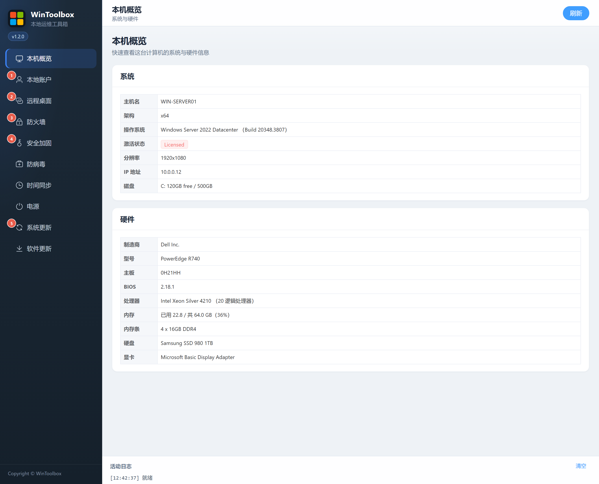

[English](90-hardening-guide.md) | [繁體中文](zh-TW/90-hardening-guide.md) | [简体中文](zh-CN/90-hardening-guide.md)

# 90 · Windows hardening guide

Use the following order to review common exposure points. Administrator privileges are required, and domain Group Policy may override local changes.

| Order | Module | Actions |
|---|---|---|
| 1 | [Local accounts](02-local-account.md) | Disable Guest/automatic logon, strengthen passwords and review lockout policies |
| 2 | [Remote Desktop](03-remote-desktop.md) | Enable only if needed, review its port and enforce NLA; align cloud security groups |
| 3 | [Firewall](04-firewall.md) | Enable profiles, allow required business ports and review ping/high-risk port blocks |
| 4 | [Security hardening](05-security-harden.md) | Disable SMBv1/WinRM only after checking dependencies; restrict anonymous enumeration |
| 5 | [Windows Update](09-windows-update.md) | Keep normal security update delivery; restore configuration after temporary maintenance |

Refresh after each change and verify the actual state. Unknown or partially applied states require investigation. File sharing and remote administration can depend on the ports/services being blocked; preserve a recovery path when changing remote access.

Other modules: [Overview](01-overview.md) · [Defender](06-defender.md) · [Time](07-time-sync.md) · [Power](08-power.md) · [App update](10-app-update.md)

Start by [downloading WinToolBox](00-download.md) and running it as administrator.

Screenshots show the earlier Simplified Chinese interface; the labels above describe the English interface. Download prompts are illustrations.
