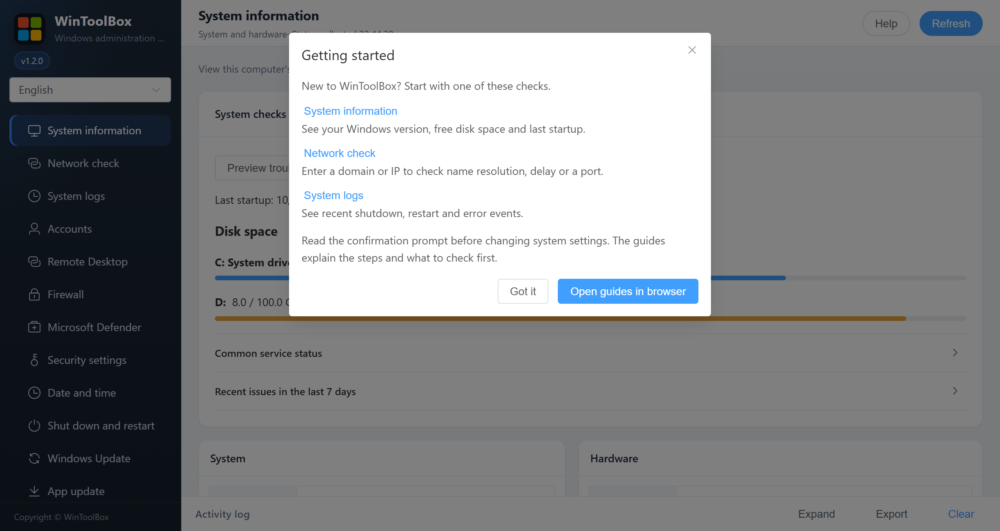

[English](README.md) · [繁體中文](zh-Hant/README.md) · [简体中文](zh-Hans/README.md)

# WinToolBox documentation

The first time you open this version, **Getting started** appears with shortcuts to System information, Network check and System logs. Select **Help** at the top to reopen it. **Open guides in browser** opens the online guides in your selected language.

English is the primary documentation language. Complete user guides are also available in [Traditional Chinese](zh-Hant/README.md) and [Simplified Chinese](zh-Hans/README.md). The application chooses the user's Windows display language on first launch and lets users save a manual preference.

Start with [Download and first launch](00-download.md). Administrator privileges are required; Group Policy may override local changes.

See [Language selection](localization.md) for automatic detection and saved preferences.

## Controls available across the app

- Use the language selector at the top left to switch between English, Simplified Chinese and Traditional Chinese. The choice is saved. **Help** reopens the first-run guide and links to the selected language's online documentation.
- **Refresh** rereads the current page. In **System logs** it rereads the log report. In **App update** it also checks for a newer version. In **Network check**, select **Start check** to run a new test.
- After confirming a change, wait for the result. **View log** opens the activity log. **Dismiss** closes the result banner. If verification is incomplete or the operation fails, check the log and current state before retrying.
- At the bottom, **Activity log** can be expanded or collapsed. **Export** saves the current WinToolBox activity as `wintoolbox-log.txt`. Review it before sharing. **Clear** empties the activity panel. Windows event records remain available in **System logs**.

| Guide | Topic |
|---|---|
| [Download and first launch](00-download.md) | Download, checksum, UAC, WebView2 and language selection |
| [System information](01-overview.md) | Overview |
| [Network check](12-network-check.md) | DNS, Ping, TCPing, local listeners, public IPs and MTR |
| [System logs](11-system-logs.md) | Startup, shutdown, reboot evidence and diagnostic export |
| [Accounts](02-local-account.md) | Local accounts |
| [Remote Desktop](03-remote-desktop.md) | Remote Desktop |
| [Firewall](04-firewall.md) | Firewall |
| [Microsoft Defender](06-defender.md) | Antivirus |
| [Security settings](05-security-harden.md) | Security hardening |
| [Date and time](07-time-sync.md) | Time synchronization |
| [Shut down and restart](08-power.md) | Power |
| [Windows Update](09-windows-update.md) | Windows Update |
| [App update](10-app-update.md) | App update |
| [Windows hardening guide](90-hardening-guide.md) | Windows hardening guide |
| [Development and acceptance](development.md) | Development and acceptance |

The screenshots use the current English app interface with sample data. Numbered markers match the controls in the guides.

Historical engineering notes: [Project review, 2026-10-08](project-review-2026-10-08.md) · [Optimization delivery, 2026-10-08](optimization-2026-10-08.md).

[Operation feedback and audit](operation-audit-2026-10-12.md)
