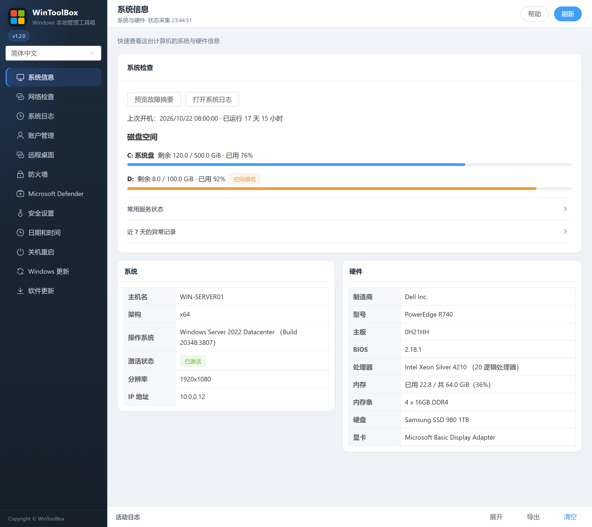

[English](../01-overview.md) · [繁體中文](../zh-Hant/01-overview.md) · [简体中文](../zh-Hans/01-overview.md)

# 01 · 系统信息

查看本机系统与硬件信息（只读，无危险操作）。

## 界面

侧栏点 **系统信息**。页面展示：

| 区块 | 内容 |
|------|------|
| **系统** | 主机名、架构、操作系统与 Build、激活、分辨率、IP、磁盘空间 |
| **硬件** | 厂商/型号、主板、BIOS、CPU、内存与内存条、物理磁盘、显卡 |

右上角 **刷新** 可重新拉取状态。部分硬件细节可能异步补全。

## 系统检查

- **磁盘空间** 显示本地固定磁盘余量，优先展示系统盘。剩余不足 2 GiB 或低于 10% 时会提示空间偏低。
- **上次开机** 显示 Windows 启动时间和读取状态时的运行时长。
- **常用服务状态** 只读取服务状态。有些服务只在需要时运行。
- **近 7 天的异常记录** 显示事件 41、6008、1001 各自最近一条匹配结果。要看详情，点 **打开系统日志**。
- **预览故障摘要** 汇总系统信息和本窗口最近一次[网络检查](12-network-check.md)的状态。复制的文本省略主机名、用户名、目标地址和 IP。

返回：[文档首页](./README.md)

[操作反馈与功能审查](operation-audit-2026-10-12.md)
