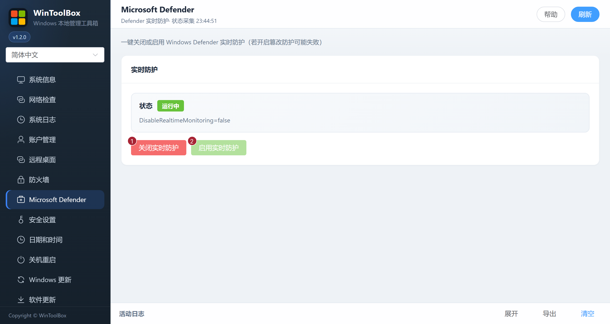

[English](../06-defender.md) · [繁體中文](../zh-Hant/06-defender.md) · [简体中文](../zh-Hans/06-defender.md)

# 06 · Microsoft Defender

一键关闭或恢复 Windows Defender **实时防护**。

## 界面标注

| # | 按钮 | 说明 |
|---|------|------|
| ① | **关闭实时防护** | 临时关闭 Defender 实时监控（有风险） |
| ② | **启用实时防护** | 重新开启实时监控 |

## 注意

- 若开启 **篡改防护**，关闭可能失败，需先在 Windows 安全中心处理
- 仅在明确需要的运维窗口关闭，用完立即 **启用实时防护**
- 状态显示「未知」时先点 **刷新**

相关：[文档首页](./README.md) · [09 · 系统更新](./09-windows-update.md)

[操作反馈与功能审查](operation-audit-2026-10-12.md)
