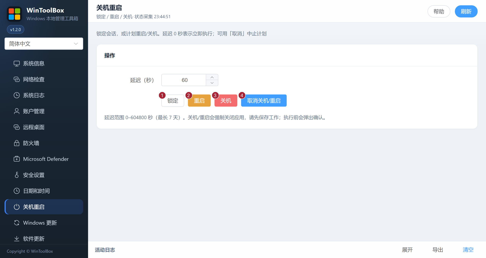

[English](../08-power.md) · [繁體中文](../zh-Hant/08-power.md) · [简体中文](../zh-Hans/08-power.md)

# 08 · 关机重启

锁定会话，或按延迟计划重启 / 关机，并可取消已计划的关机与重启。

## 界面标注

| # | 按钮 | 说明 |
|---|------|------|
| ① | **锁定** | 锁定当前会话（不影响计划关机） |
| ② | **重启** | 按「延迟（秒）」计划重启；0 表示立即（会确认） |
| ③ | **关机** | 按延迟计划关机；0 表示立即（会确认） |
| ④ | **取消关机/重启** | 中止已计划的关机或重启 |

延迟范围 0–604800 秒（最长 7 天）。远程操作前请确认不会误关生产机。

相关：[文档首页](./README.md) · [07 · 时间同步](./07-time-sync.md)

[操作反馈与功能审查](operation-audit-2026-10-12.md)
