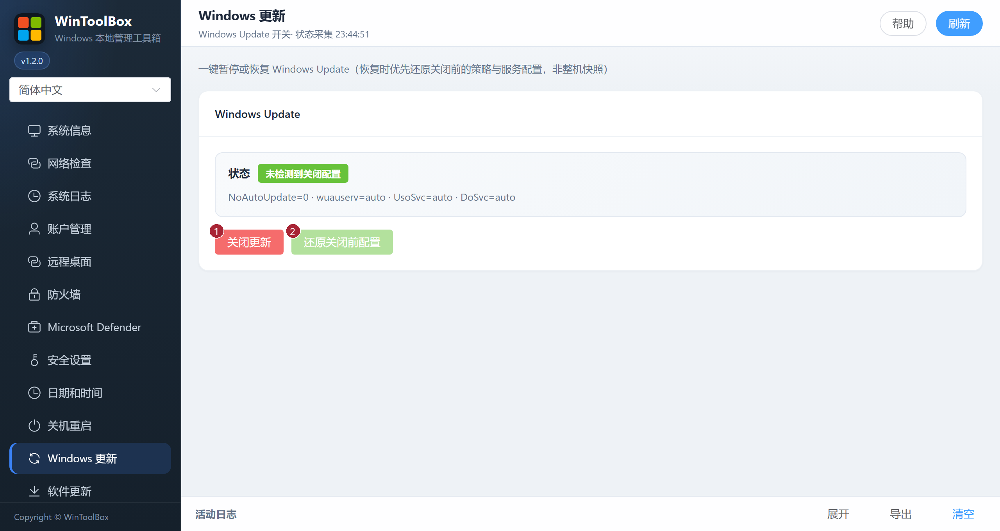

[English](../09-windows-update.md) · [繁體中文](../zh-Hant/09-windows-update.md) · [简体中文](../zh-Hans/09-windows-update.md)

# 09 · Windows 更新

一键暂停或恢复 Windows Update（恢复时优先还原关闭前的策略与服务配置，非整机快照）。

## 界面标注

| # | 按钮 | 说明 |
|---|------|------|
| ① | **关闭更新** | 暂停 Windows Update 相关策略/服务 |
| ② | **还原关闭前配置** | 尽量还原关闭前配置 |

还原会应用关闭前保存的配置。若原本已禁用，还原后仍是禁用。没有备份时会使用建议的开启配置，损坏的备份会被拒绝。操作后点 **刷新** 核对状态。

## 建议

- **常态建议保持更新开启**；仅在临时运维窗口关闭
- 关闭后记得用 ② 恢复
- 域/组策略环境可能无法被本工具完全覆盖

相关：[90 · 系统加固指南](./90-hardening-guide.md) · [10 · 软件更新](./10-app-update.md)

[操作反馈与功能审查](operation-audit-2026-10-12.md)
