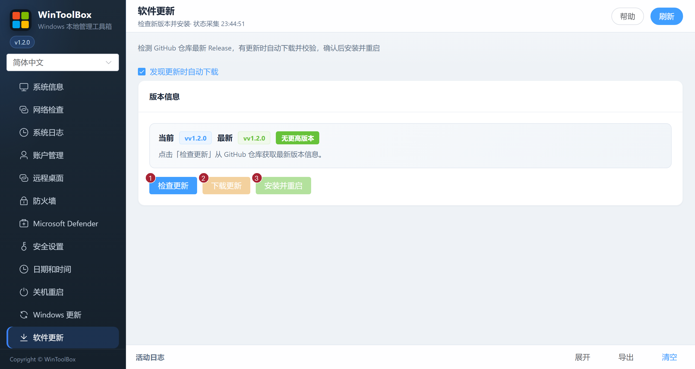

[English](../10-app-update.md) · [繁體中文](../zh-Hant/10-app-update.md) · [简体中文](../zh-Hans/10-app-update.md)

# 10 · 软件更新

检测 GitHub 仓库最新 Release，下载并校验后安装重启 WinToolBox 自身。

## 界面标注

| # | 按钮 | 说明 |
|---|------|------|
| ① | **检查更新** | 从 GitHub 拉取最新版本信息 |
| ② | **下载更新** | 有新版本时下载安装包并校验 |
| ③ | **安装并重启** | 校验通过后替换并重启应用 |

页面会显示当前 / 最新版本、是否有更新、校验状态与本地路径等信息。

## 步骤

1. **软件更新** → **检查更新**
2. 若提示有更新 → **下载更新**（等待校验成功）
3. **安装并重启**

**发现更新时自动下载** 默认开启。关闭后可手动检查和下载，选择会保存在本机。下载时会显示进度和速度，可点 **取消下载**。取消后可重新下载。只有通过 SHA256 校验后才能 **安装并重启**。

更新需能访问 GitHub。遇到网络错误可查看底部 **活动日志**。替换或启动失败时，更新程序会尝试恢复原 EXE，安装日志可在用户缓存目录的 `WinToolbox/updates/last-install.log` 中查看。已安装较早 1.2.0 构建的用户需手动下载并替换当前发布包，自动更新只识别更高版本。

相关：[文档首页](./README.md) · [00 · 下载](./00-download.md)

[操作反馈与功能审查](operation-audit-2026-10-12.md)
