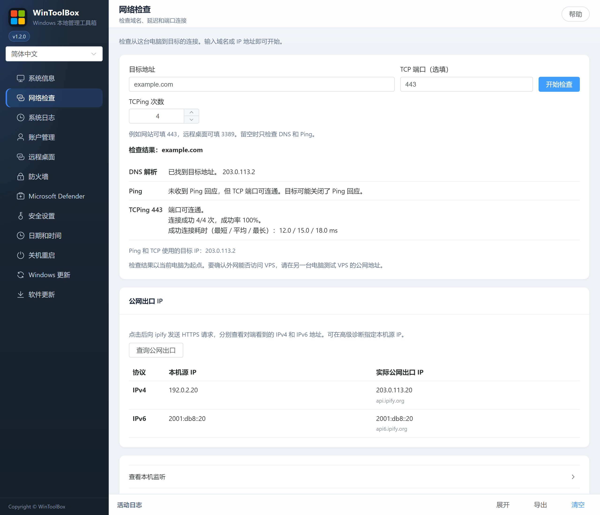
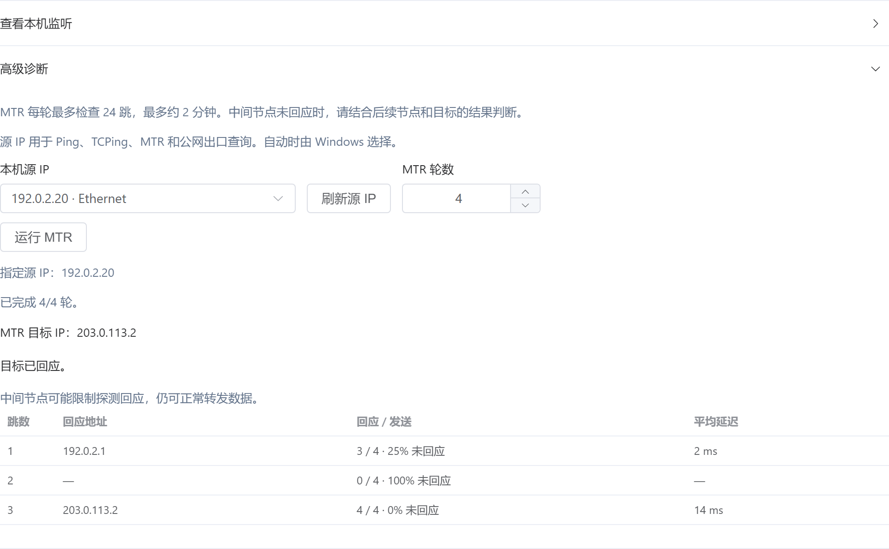

[English](../12-network-check.md) · [繁體中文](../zh-Hant/12-network-check.md) · [简体中文](../zh-Hans/12-network-check.md)

# 12 · 网络检查

输入域名或 IP，点 **开始检查**。

- **DNS 解析** 显示 Windows 提供给应用连接的地址。直接填写 IP 会跳过解析。要测试解析列表里的其他地址，直接把它填进目标栏。
- **Ping** 发送 4 次请求，显示回应次数、未回应比例和平均延迟。
- **TCPing** 在填写 TCP 端口后可用，例如网站常用的 `443`。选择 1–10 次，再点 **开始检查**。结果显示连接成功率，以及成功样本的最短、平均和最长连接耗时。端口可连通后，仍可另行核对登录和应用服务。

## 公网出口 IP

点 **查询公网出口** 后，工具才会向 ipify 发送直连 HTTPS 请求。IPv4 使用 `api.ipify.org`，IPv6 使用 `api6.ipify.org`。结果分两行，并排显示这次连接实际使用的本机源 IP，以及查询端点看到的公网 IP。某一行未取得地址，表示本次查询没有结果，可先检查对应协议能否访问查询端点。

多网卡或多 IP 的电脑可展开 **高级诊断**，选择 **本机源 IP**，再回到 **查询公网出口**。所选地址用于 Ping、TCPing、MTR 和公网查询。选 **自动选择** 时由 Windows 决定。手动选源后，公网查询只测对应协议，目标地址也要和所选源 IP 属于同一协议。网卡地址有变化时可点 **刷新源 IP**。

如果两个本机地址经过同一个 NAT 出网，它们可能显示相同的公网 IP。结果对应到查询端点的这条线路。云 NAT、VPN 和路由策略可能让其他连接使用不同的公网 IP。

## MTR 和本机监听

展开 **高级诊断**，设置 **MTR 轮数** 为 1–10，再点 **运行 MTR**。每轮最多探测 24 跳，最长约两分钟。点 **停止 MTR** 会在当前探测结束后停止，并保留已取得的结果。若某一跳未回应但后续节点有回应，该节点可能限制了探测回应。

排查 VPS 时，可在 VPS 上填写端口，再展开 **查看本机监听**，点 **检查本机端口**。要确认外网是否能访问，请在另一台电脑对 VPS 公网 IP 做 TCPing。云安全组和本机防火墙都可能影响外部连接。
