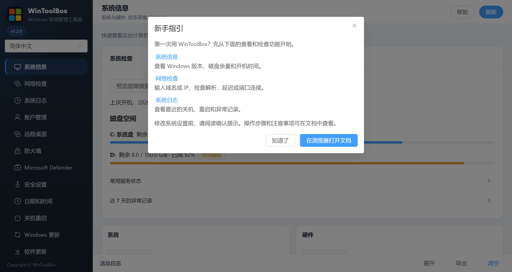

[English](../README.md) · [繁體中文](../zh-Hant/README.md) · [简体中文](../zh-Hans/README.md)

# WinToolBox 文档

首次打开新版时，会弹出 **新手指引**，可直接进入系统信息、网络检查或系统日志。以后点顶部 **帮助** 可再次查看。点 **在浏览器打开文档**，会打开当前语言的在线文档。

截图使用当前应用的简体中文界面和示例数据。图中的编号对应操作说明。

## 通用操作

- 左上角可切换简体中文、繁体中文或 English，选择会自动保存。顶部 **帮助** 可重开新手指引，并进入当前语言的在线文档。
- **刷新** 重新读取当前页面。在 **系统日志** 中会重新读取日志报告，在 **软件更新** 中还会检查新版本。**网络检查** 通过 **开始检查** 重新测试。
- 确认操作后，等待执行和复查完成。**查看日志** 会展开活动日志，**关闭提示** 会收起结果提示。遇到复查不完整或失败时，先看日志并核对当前状态，再决定是否重试。
- 底部 **活动日志** 可 **展开** 或 **收起**。**导出** 保存当前活动为 `wintoolbox-log.txt`，分享前请先核对内容。**清空** 只清空活动面板，Windows 事件仍可在 **系统日志** 中查看。

## 功能文档

| 文档 | 说明 |
|------|------|
| [00 · 下载](./00-download.md) | 下载、拦截、校验、管理员运行 |
| [系统信息](./01-overview.md) | 系统与硬件信息 |
| [网络检查](./12-network-check.md) | DNS、Ping、TCPing、本机监听、公网出口与 MTR |
| [系统日志](./11-system-logs.md) | 开关机、重启、异常证据、关联分析与导出 |
| [账户管理](./02-local-account.md) | 来宾/自动登录、密码策略、锁定、改密 |
| [远程桌面](./03-remote-desktop.md) | 端口、开关、NLA、连接记录 |
| [防火墙](./04-firewall.md) | 配置文件、放行、禁 ping、高危端口 |
| [Microsoft Defender](./06-defender.md) | Defender 实时防护开关 |
| [安全设置](./05-security-harden.md) | SMBv1、WinRM、匿名枚举 |
| [日期和时间](./07-time-sync.md) | 时区、NTP、对时与测试 |
| [关机重启](./08-power.md) | 锁定 / 重启 / 关机 / 取消 |
| [Windows 更新](./09-windows-update.md) | Windows Update 开关 |
| [软件更新](./10-app-update.md) | 本软件检查、下载、安装 |
| [90 · 系统加固指南](./90-hardening-guide.md) | 推荐顺序：账户 → RDP → 防火墙 → 加固 → 更新 |

需**管理员权限**。域环境可能被组策略覆盖。

[语言选择](localization.md)

[操作反馈与功能审查](operation-audit-2026-10-12.md)
