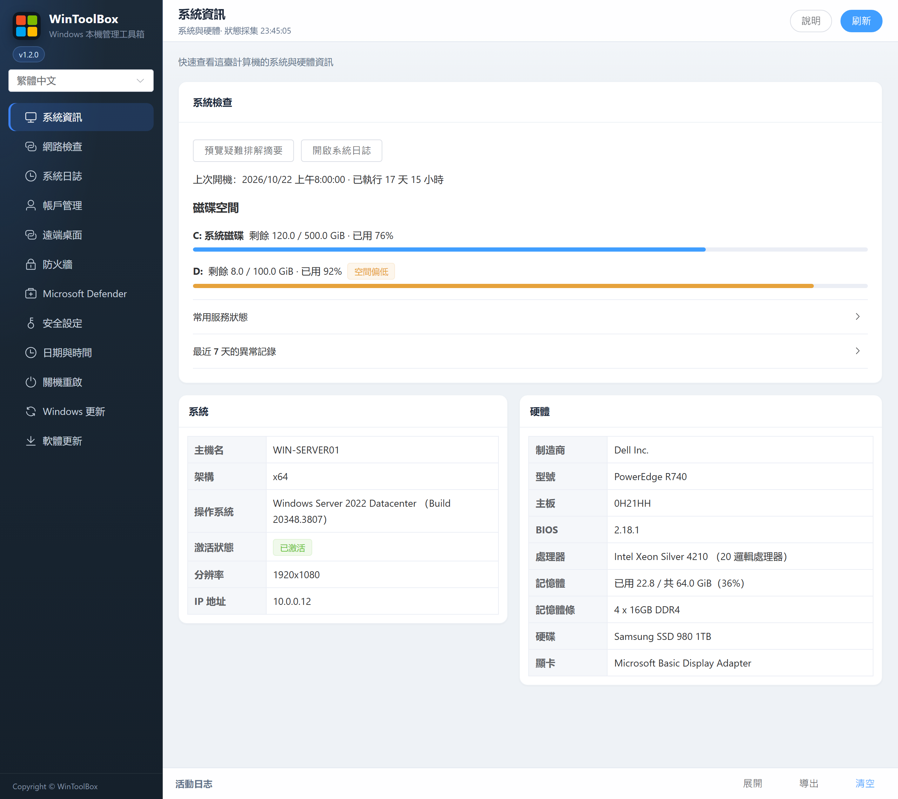

[English](../01-overview.md) · [繁體中文](../zh-Hant/01-overview.md) · [简体中文](../zh-Hans/01-overview.md)

# 01 · 系統資訊

查看本機系統與硬體資訊（只讀，無危險操作）。

## 介面

側欄點 **系統資訊**。頁面展示：

| 區塊 | 內容 |
|------|------|
| **系統** | 主機名、架構、操作系統與 Build、激活、分辨率、IP、磁盤空間 |
| **硬體** | 廠商/型號、主板、BIOS、CPU、記憶體與記憶體條、物理磁盤、顯卡 |

右上角 **刷新** 可重新拉取狀態。部分硬體細節可能異步補全。

## 系統檢查

- **磁碟空間** 顯示本機固定磁碟剩餘容量，優先顯示系統磁碟。剩餘不足 2 GiB 或低於 10% 時會提示空間偏低。
- **上次開機** 顯示 Windows 啟動時間和讀取狀態時的執行時間。
- **常用服務狀態** 只讀取服務狀態。部分服務只在需要時執行。
- **最近 7 天的異常記錄** 顯示事件 41、6008、1001 各自最新一筆符合條件的結果。要看詳情，按 **開啟系統日誌**。
- **預覽疑難排解摘要** 彙整系統資訊和這個視窗最近一次[網路檢查](12-network-check.md)的狀態。複製的文字會省略主機名稱、使用者名稱、目標位址和 IP。

返回：[文件首頁](./README.md)

[操作回饋與功能審查](operation-audit-2026-10-12.md)
