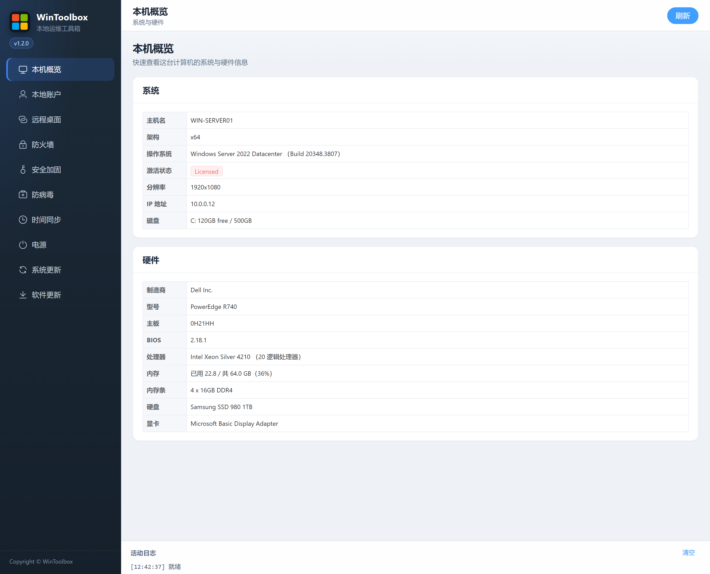

[English](../01-overview.md) | [繁體中文](../zh-Hant/01-overview.md) | [簡體中文](../zh-Hans/01-overview.md)

# 01 · 本機概覽

查看本機系統與硬體資訊（只讀，無危險操作）。

## 第一步：下載

https://github.com/lucaswren/wintoolbox/releases/latest

攔截點 **保留 / 保持**。詳：[00 · 下載](./00-download.md)

## 介面

側欄點 **本機概覽**。頁面展示：

| 區塊 | 內容 |
|------|------|
| **系統** | 主機名、架構、操作系統與 Build、激活、分辨率、IP、磁盤空間 |
| **硬體** | 廠商/型號、主板、BIOS、CPU、記憶體與記憶體條、物理磁盤、顯卡 |

右上角 **刷新** 可重新拉取狀態。部分硬體細節可能異步補全。

返回：[文件首頁](./README.md)
