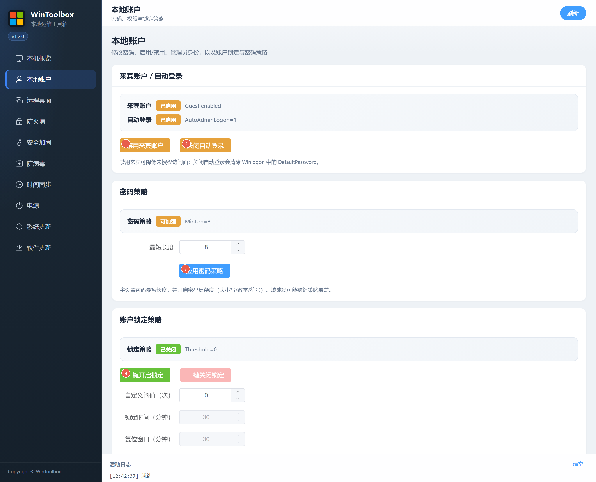
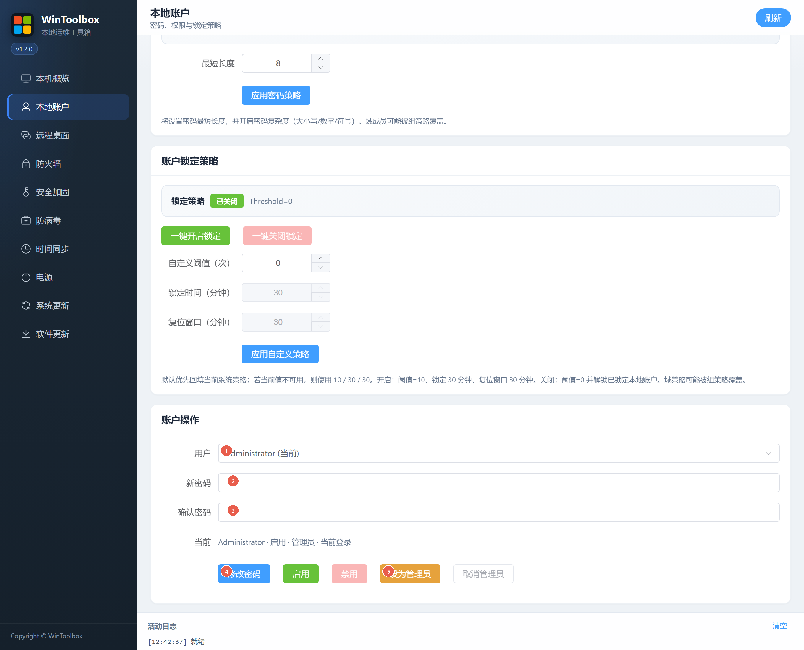

[English](../02-local-account.md) · [繁體中文](../zh-Hant/02-local-account.md) · [简体中文](../zh-Hans/02-local-account.md)

# 02 · 本地帳戶

停用來賓與自動登錄、加強密碼/鎖定策略，以及修改本地使用者密碼與權限。

## 第一步：下載

https://github.com/lucaswren/wintoolbox/releases/latest

攔截點 **保留 / 保持**。詳：[00 · 下載](./00-download.md)

## 策略與加固入口

| # | 按鈕 | 說明 |
|---|------|------|
| ① | **停用來賓帳戶** | 關閉 Guest，降低未授權入口 |
| ② | **關閉自動登錄** | 關 AutoAdminLogon，並清除 DefaultPassword |
| ③ | **應用密碼策略** | 設置最短長度，並開啟復雜度 |
| ④ | **一鍵開啟鎖定** | 預設約 10 次失敗 / 鎖定 30 分鐘（可自定義） |

也可在同頁填寫閾值後點 **應用自定義策略**。

## 修改密碼與權限

向下滾動到 **帳戶操作**：

| # | 選項 | 說明 |
|---|------|------|
| ① | **使用者** | 選擇本地帳戶 |
| ② | **新密碼** | 輸入新密碼 |
| ③ | **確認密碼** | 與 ② 一致 |
| ④ | **修改密碼** | 確認後生效 |
| ⑤ | **設為系統管理員** | 將所選使用者加入系統管理員組（旁有啟用/停用、取消系統管理員） |

## 建議步驟

1. 系統管理員打開 WinToolBox → **本地帳戶**
2. ①②③④ 按需加固
3. 選使用者 → 填兩次密碼 → **修改密碼**
4. 用新密碼登錄驗證一次

密碼建議長度 ≥ 12（伺服器 ≥ 14），含大小寫、數字與符號。本頁只管**本地帳戶**（域帳戶受域策略約束）。

相關：[90 · 系統加固指南](./90-hardening-guide.md) · [03 · 遠端桌面](./03-remote-desktop.md)

[操作回饋與功能審查](operation-audit-2026-10-12.md)
