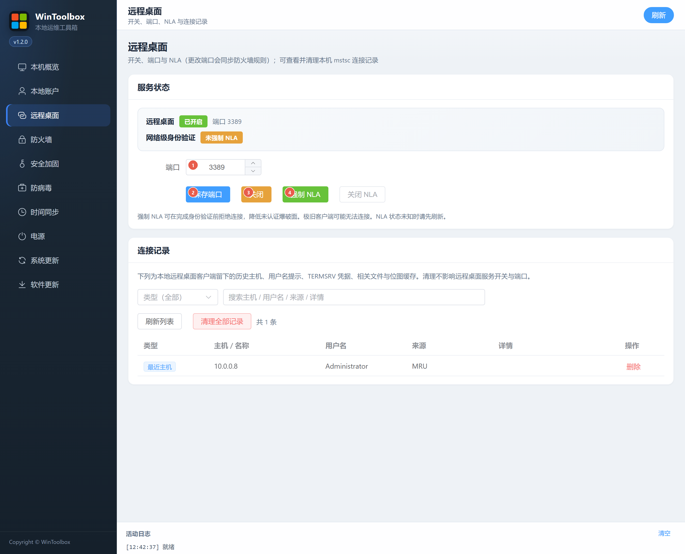

[English](../03-remote-desktop.md) · [繁體中文](../zh-Hant/03-remote-desktop.md) · [简体中文](../zh-Hans/03-remote-desktop.md)

# 03 · 遠端桌面

修改 RDP 連接埠、開關服務、強制 NLA，並管理本機連線記錄。

## 第一步：下載

https://github.com/lucaswren/wintoolbox/releases/latest

攔截點 **保留 / 保持**。詳：[00 · 下載](./00-download.md)

## 介面標注

| # | 選項 | 說明 |
|---|------|------|
| ① | **連接埠** | 1–65535，避免長期使用 3389 |
| ② | **保存連接埠** | 寫注冊表，並同步 `WinToolbox-RDP` 防火牆放行 |
| ③ | **開啟 / 關閉** | 開關遠端桌面服務（圖示為已開啟時的「關閉」） |
| ④ | **強制 NLA** | 認證前拒絕連線；極舊客戶端可能連不上 |

下方 **連線記錄** 可篩選、刪除單條或 **清理全部記錄**（含主機歷史、憑據提示等快取）。

## 步驟

1. **遠端桌面** → 填寫連接埠（①）→ **保存連接埠**（②）
2. 未開啟則點 **開啟**（③）→ **強制 NLA**（④）
3. 客戶端使用 `IP:新連接埠`；雲主機請同步安全組

## 注意

- 公網請確認安全組是否仍放行舊 3389
- 狀態異常時先點右上角 **刷新**

相關：[90 · 系統加固指南](./90-hardening-guide.md) · [02 · 本地帳戶](./02-local-account.md)

[操作回饋與功能審查](operation-audit-2026-10-12.md)
