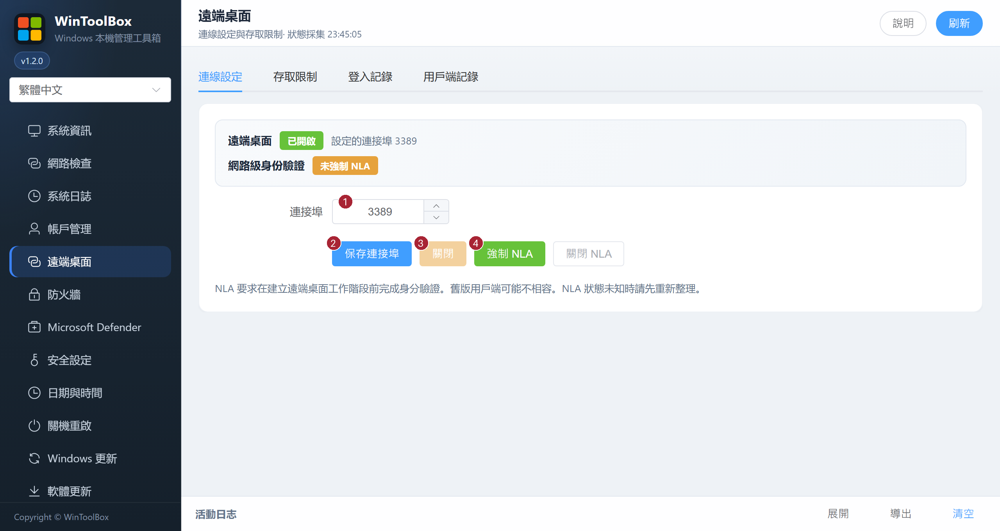

[English](../03-remote-desktop.md) · [繁體中文](../zh-Hant/03-remote-desktop.md) · [简体中文](../zh-Hans/03-remote-desktop.md)

# 03 · 遠端桌面

管理 RDP 連線設定、來源 IP 白名單與伺服器登入記錄。

只想查看遠端桌面是否開啟？開啟 **遠端桌面 → 連線設定**，查看狀態即可。如果目前能正常連線，有需要時再變更連接埠。操作遠端伺服器前，先確認能開啟服務商提供的主控台。

## 介面標註

| # | 選項 | 說明 |
|---|------|------|
| ① | **連接埠** | 保護流程接受 1024–65535；更換連接埠不能替代來源限制 |
| ② | **保存連接埠** | 保存原設定、建立 SYSTEM 還原工作並新增受限 TCP/UDP 規則；約十秒後重啟 RDP 服務 |
| ③ | **開啟 / 關閉** | 開關遠端桌面服務（圖示為已開啟時的「關閉」） |
| ④ | **強制 NLA** | 連線到桌面前驗證身分，舊版用戶端可能無法連線 |

頁面依連線設定、**存取限制**、**登入記錄**排列。規則與原始輸出預設收合於 **診斷詳情**；登入記錄按需讀取並可展開詳細資料。**用戶端記錄**保留歷史主機、憑證、相關檔案與快取的搜尋、類型篩選、單筆刪除、分類清理及全部清理，開啟頁籤時讀取。

## 步驟

1. 如果遠端桌面已關閉，而且確實需要使用，請從本機或服務商主控台按 **開啟**（③）。
2. 若要更換連接埠，先在雲端安全群組放行新連接埠，再填寫新連接埠（①）並按 **保存連接埠**（②）。遠端桌面服務約十秒後重新啟動，目前的連線會中斷。
3. 五分鐘內用 `IP:新連接埠` 重新連線，在新連線中按頂端的確認按鈕以保留設定。連線失敗或未按時確認時，工具會還原原本的設定。
4. 上一項變更完成後，再按需要選擇 **強制 NLA**（④），讓系統在開啟遠端桌面前先驗證身分。這項變更也需要重新連線並確認。

新增來源 IP/CIDR 白名單、TermService 真實監聽檢查、有效策略規則列表，以及伺服器登入與斷線事件。NLA 和啟用全部防火牆也使用保護流程；既有連線不能確認保留。網域控制站、未知會話或受管 RDP 策略會保守拒絕修改。

**登入記錄** 可選 1–90 天，支援來源彙總、失敗原因、重複失敗線索、搜尋、原文/XML 詳情及完整 JSON 匯出。網路驗證失敗與已確認的遠端互動式登入分開統計，通道不可讀時提示資料可能不完整。**清空結果** 僅重設目前顯示，不刪除 Windows 原始日誌。

請先保留 VPS 控制臺通道。本機還原無法修復雲端安全組、NAT 或系統故障；仍需在各 Windows Server Desktop Experience 版本實機驗收。完整流程、限制與復原方式見[簡體中文保護指南](../zh-Hans/03-remote-desktop.md#vps-防失联保护)。

## 注意

- 公網請確認安全組是否仍放行舊 3389
- 狀態異常時先點右上角 **刷新**

相關：[90 · 系統加固指南](./90-hardening-guide.md) · [02 · 本地帳戶](./02-local-account.md)

[操作回饋與功能審查](operation-audit-2026-10-12.md)
