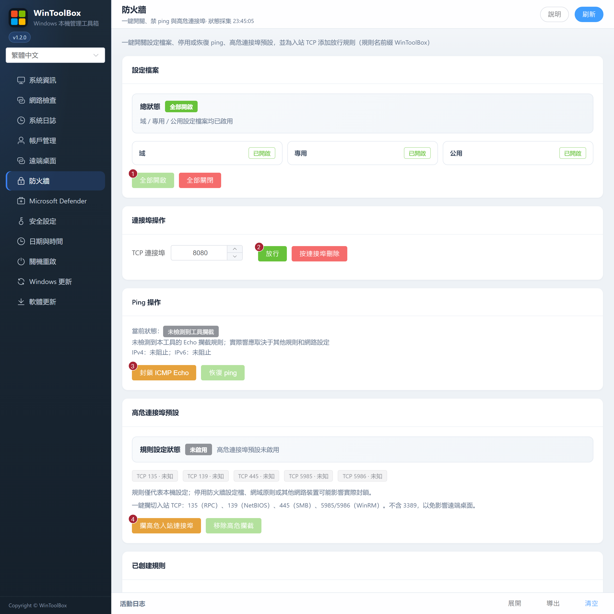

[English](../04-firewall.md) · [繁體中文](../zh-Hant/04-firewall.md) · [简体中文](../zh-Hans/04-firewall.md)

# 04 · 防火牆

一鍵開關設定檔案、禁 ping、攔高危入站連接埠，以及按連接埠放行/刪除規則。

## 介面標注

| # | 按鈕 | 說明 |
|---|------|------|
| ① | **全部開啟** | 域 / 專用 / 公用設定檔案全部啟用（旁有「全部關閉」） |
| ② | **放行** | 為填寫的 TCP 連接埠添加入站放行（規則名前綴 `WinToolbox-Allow-`） |
| ③ | **封鎖 ICMP Echo** | 阻止 ICMPv4/v6 Echo（可 **恢復 ping**） |
| ④ | **攔高危入站連接埠** | 攔 135 / 139 / 445 / 5985 / 5986（**不含 3389**） |

同頁還可 **按連接埠刪除**、**移除高危攔截**，以及管理「已創建規則」列表。

在 **已創建規則** 可逐筆 **刪除**，也可填寫連接埠後按 **按連接埠刪除**。**刪除全部放行規則** 只刪除此工具建立的普通放行規則，規則名稱以 `WinToolbox-Allow-` 開頭。刪除規則或關閉全部防火牆設定檔，請從本機或服務商主控台操作。遠端啟用全部設定檔前須有可驗證的 RDP 監聽與放行規則，重新連線後要在頂部確認。詳見[遠端桌面復原](03-remote-desktop.md#存取限制與復原)。

## 步驟

1. **防火牆** → 確認設定檔案為開啟（必要時 ①）
2. 運維需要時用 ② 放行業務連接埠
3. 加固：③ 禁 ping → ④ 攔高危連接埠

依賴檔案共享 / WinRM 時慎用 ④。雲主機還需在安全組同步策略。

相關：[90 · 系統加固指南](./90-hardening-guide.md) · [05 · 安全加固](./05-security-harden.md)

[操作回饋與功能審查](operation-audit-2026-10-12.md)

確認系統操作後，持續提示欄顯示執行、複查及耗時，請等待最終結果。複查警告表示命令已返回但讀取不完整；失敗也可能已有部分變更，請勿盲目重複。逐一檢查連接埠結果並重新整理未知狀態；已啟用的自訂遠端桌面連接埠若與預設清單衝突，會中止封鎖。本機規則存在不保證網路過濾生效，仍受設定檔與原則影響。
