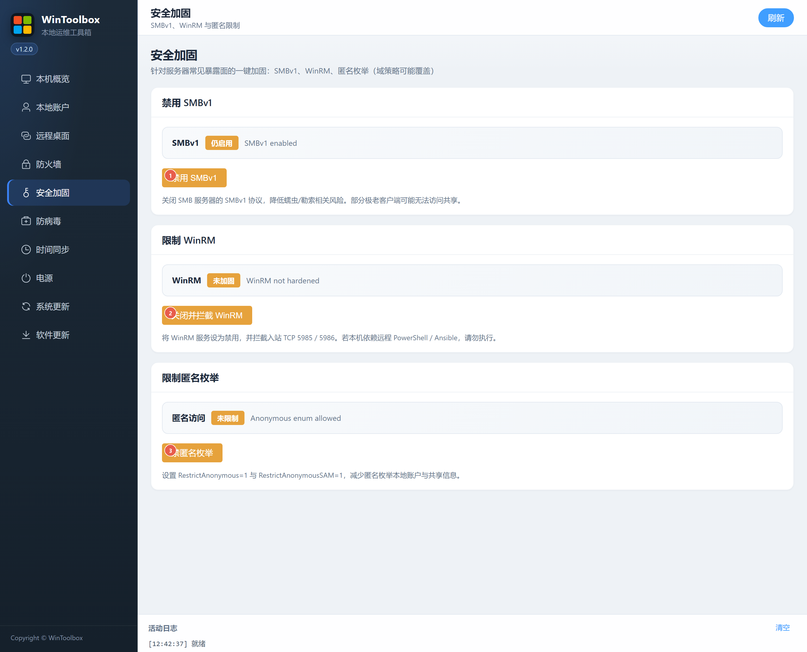

[English](../05-security-harden.md) · [繁體中文](../zh-Hant/05-security-harden.md) · [简体中文](../zh-Hans/05-security-harden.md)

# 05 · 安全加固

針對常見暴露面：停用 SMBv1、關閉並攔截 WinRM、限制匿名枚舉。

## 第一步：下載

https://github.com/lucaswren/wintoolbox/releases/latest

攔截點 **保留 / 保持**。詳：[00 · 下載](./00-download.md)

## 介面標注

| # | 按鈕 | 說明 |
|---|------|------|
| ① | **停用 SMBv1** | 關閉 SMB 伺服器的 SMBv1，降低蠕蟲/勒索相關風險 |
| ② | **關閉並攔截 WinRM** | 停用 WinRM 服務，並攔入站 TCP 5985 / 5986 |
| ③ | **禁匿名枚舉** | RestrictAnonymous / RestrictAnonymousSAM |

## 注意

- 極老客戶端訪問共享時慎用 ①
- 依賴遠端 PowerShell / Ansible 時**不要**執行 ②
- 域環境可能被組策略覆蓋；操作後可用右上角 **刷新** 核對狀態

相關：[90 · 系統加固指南](./90-hardening-guide.md) · [04 · 防火牆](./04-firewall.md)

[操作回饋與功能審查](operation-audit-2026-10-12.md)
