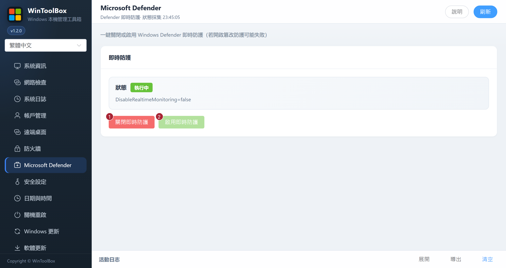

[English](../06-defender.md) · [繁體中文](../zh-Hant/06-defender.md) · [简体中文](../zh-Hans/06-defender.md)

# 06 · Microsoft Defender

一鍵關閉或恢復 Windows Defender **即時防護**。

## 介面標注

| # | 按鈕 | 說明 |
|---|------|------|
| ① | **關閉即時防護** | 臨時關閉 Defender 即時監控（有風險） |
| ② | **啟用即時防護** | 重新開啟即時監控 |

## 注意

- 若開啟 **篡改防護**，關閉可能失敗，需先在 Windows 安全中心處理
- 僅在明確需要的運維窗口關閉，用完立即 **啟用即時防護**
- 狀態顯示「未知」時先點 **刷新**

相關：[文件首頁](./README.md) · [09 · 系統更新](./09-windows-update.md)

[操作回饋與功能審查](operation-audit-2026-10-12.md)
