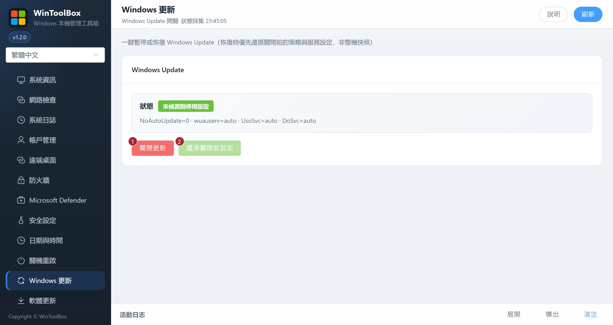

[English](../09-windows-update.md) · [繁體中文](../zh-Hant/09-windows-update.md) · [简体中文](../zh-Hans/09-windows-update.md)

# 09 · Windows 更新

一鍵暫停或恢復 Windows Update（恢復時優先還原關閉前的策略與服務設定，非整機快照）。

## 介面標注

| # | 按鈕 | 說明 |
|---|------|------|
| ① | **關閉更新** | 暫停 Windows Update 相關策略/服務 |
| ② | **還原關閉前設定** | 盡量還原關閉前設定 |

還原會套用關閉前儲存的設定。若原本已停用，還原後仍會停用。沒有備份時會使用建議的啟用設定，損壞的備份會被拒絕。操作後按 **刷新** 核對狀態。

## 建議

- **常態建議保持更新開啟**；僅在臨時運維窗口關閉
- 關閉後記得用 ② 恢復
- 域/組策略環境可能無法被本工具完全覆蓋

相關：[90 · 系統加固指南](./90-hardening-guide.md) · [10 · 軟體更新](./10-app-update.md)

[操作回饋與功能審查](operation-audit-2026-10-12.md)
