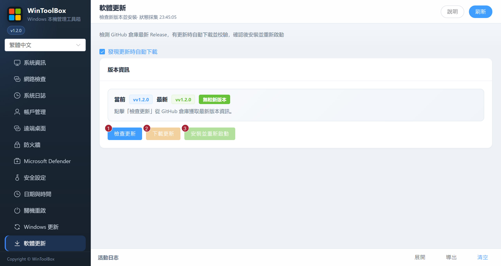

[English](../10-app-update.md) · [繁體中文](../zh-Hant/10-app-update.md) · [简体中文](../zh-Hans/10-app-update.md)

# 10 · 軟體更新

檢測 GitHub 倉庫最新 Release，下載並校驗後安裝重新啟動 WinToolBox 自身。

## 介面標注

| # | 按鈕 | 說明 |
|---|------|------|
| ① | **檢查更新** | 從 GitHub 拉取最新版本資訊 |
| ② | **下載更新** | 有新版本時下載安裝包並校驗 |
| ③ | **安裝並重新啟動** | 校驗通過後替換並重新啟動應用 |

頁面會顯示當前 / 最新版本、是否有更新、校驗狀態與本機路徑等資訊。

## 步驟

1. **軟體更新** → **檢查更新**
2. 若提示有更新 → **下載更新**（等待校驗成功）
3. **安裝並重新啟動**

**發現更新時自動下載** 預設開啟。關閉後可手動檢查及下載，選擇會儲存在本機。下載時會顯示進度和速度，可按 **取消下載**，之後再重新下載。通過 SHA256 校驗後才能 **安裝並重新啟動**。

更新需能連線至 GitHub。遇到網路錯誤可查看底部 **活動日誌**。替換或啟動失敗時，更新程式會嘗試還原原本的 EXE，安裝日誌可在使用者快取目錄的 `WinToolbox/updates/last-install.log` 查看。已安裝較早 1.2.0 版本的使用者需手動下載並替換目前的發行版本，自動更新只會識別更高的版本。

相關：[文件首頁](./README.md) · [00 · 下載](./00-download.md)

[操作回饋與功能審查](operation-audit-2026-10-12.md)
