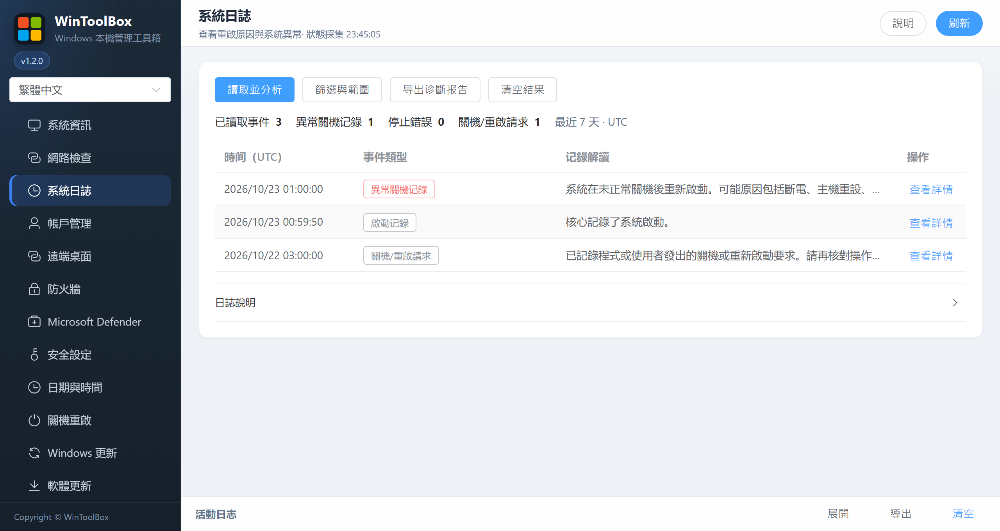

[English](../11-system-logs.md) · [繁體中文](../zh-Hant/11-system-logs.md) · [简体中文](../zh-Hans/11-system-logs.md)

# 11 · 系統日誌

從側欄開啟 **系統日誌**，按 **讀取並分析** 查看近期開機、關機與故障記錄。需要調整時間或筆數時，開啟 **篩選與範圍**。可搜尋、分類、展開原文、XML、結構化欄位及前後十分鐘的關聯證據，並匯出 JSON 診斷報告。此功能不更改系統或稽核設定。

統計為事件筆數，不是重新啟動次數。事件 41、6008、1001 可能描述同一次故障；時間接近不能證明因果關係。41 不能單獨證明斷電，還須檢查停止代碼、記憶體傾印、WHEA、儲存、服務、監控及 VPS 服務商紀錄。日誌停用、權限不足、讀取失敗與截斷會明確提示；空清單不代表系統沒有問題。

時間線統一顯示 UTC。匯出包含整次讀取結果，可能含主機、帳戶與檔案路徑，分享前請核對。完整事件編號和排查流程見[簡體中文指南](../zh-Hans/11-system-logs.md)；事件解讀依據見[微軟異常重新啟動排查](https://learn.microsoft.com/en-us/troubleshoot/windows-server/performance/troubleshoot-unexpected-reboots-system-event-logs)。

**清空結果** 重設目前顯示的記錄、統計、詳情、篩選與錯誤提示，不刪除 Windows 原始日誌。讀取期間停用，重新讀取仍可載入歷史記錄。

預設顯示操作按鈕、簡短統計和關鍵記錄；時間、筆數、分類與搜尋放在預設收起的 **篩選與範圍**。完整說明與採集資訊可開啟 **日誌說明**，原文、欄位、XML 及關聯記錄可在事件詳情分別展開。失敗與日誌不完整仍保留簡短提示。
