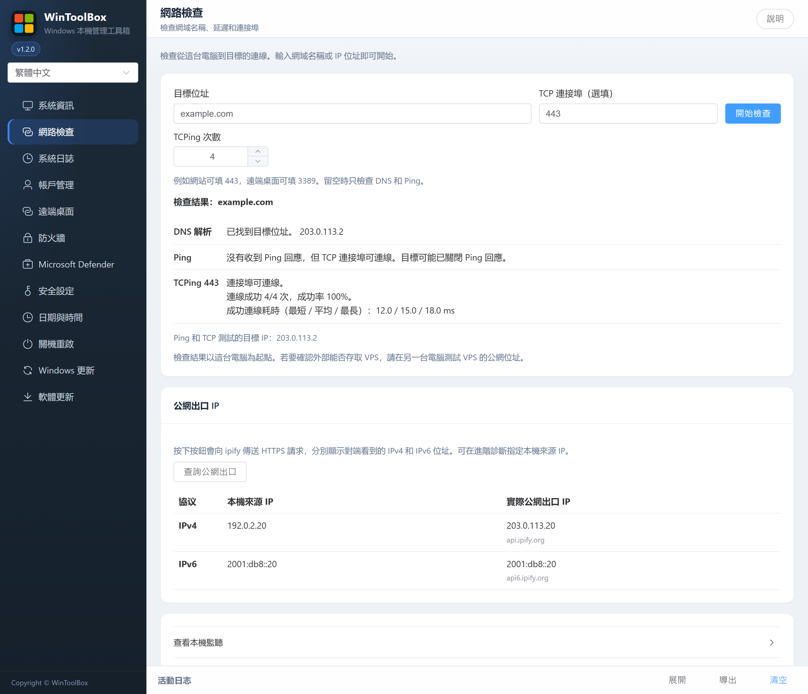
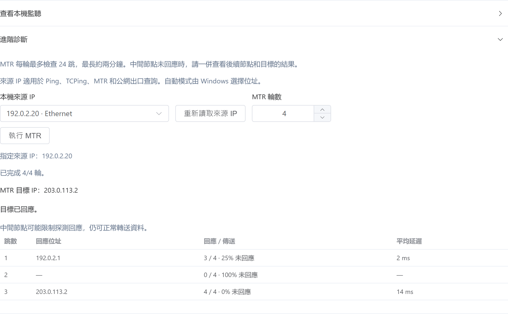

[English](../12-network-check.md) · [繁體中文](../zh-Hant/12-network-check.md) · [简体中文](../zh-Hans/12-network-check.md)

# 12 · 網路檢查

輸入網域名稱或 IP，按 **開始檢查**。

- **DNS 解析** 顯示 Windows 提供給應用程式連線的位址。直接填寫 IP 會跳過解析。要測試解析清單中的其他位址，可直接將它填入目標欄。
- **Ping** 傳送 4 次請求，顯示回應次數、未回應比例和平均延遲。
- **TCPing** 在填寫 TCP 連接埠後可用，例如網站常用的 `443`。選擇 1–10 次，再按 **開始檢查**。結果顯示連線成功率，以及成功樣本的最短、平均和最長連線耗時。連接埠可連線後，仍可另外核對登入和應用程式服務。

## 公網出口 IP

按 **查詢公網出口** 後，工具才會向 ipify 傳送直連 HTTPS 請求。IPv4 使用 `api.ipify.org`，IPv6 使用 `api6.ipify.org`。結果分成兩列，並排顯示此次連線實際使用的本機來源 IP，以及查詢端點看到的公網 IP。某一列未取得位址，表示本次查詢沒有結果，可先檢查對應協定能否連到查詢端點。

多網路介面或多 IP 的電腦可展開 **進階診斷**，選擇 **本機來源 IP**，再回到 **查詢公網出口**。所選位址用於 Ping、TCPing、MTR 和公網查詢。選 **自動選擇** 時由 Windows 決定。手動選擇來源後，公網查詢只測試對應協定，目標位址也必須與來源 IP 使用同一協定。網路介面的位址變更時，可按 **重新讀取來源 IP**。

如果兩個本機位址經由同一個 NAT 連到網際網路，可能會顯示相同的公網 IP。結果對應到查詢端點的這條線路。雲端 NAT、VPN 和路由設定可能讓其他連線使用不同的公網 IP。

## MTR 與本機監聽

展開 **進階診斷**，將 **MTR 輪數** 設為 1–10，再按 **執行 MTR**。每輪最多探測 24 跳，最長約兩分鐘。按 **停止 MTR** 會在目前探測結束後停止，並保留已取得的結果。若其中一跳未回應，但後續節點有回應，該節點可能限制了探測回應。

排查 VPS 時，可在 VPS 上填寫連接埠，再展開 **查看本機監聽**，按 **檢查本機連接埠**。若要確認外部能否存取，請在另一台電腦對 VPS 公網 IP 執行 TCPing。雲端安全群組和本機防火牆都可能影響外部連線。
