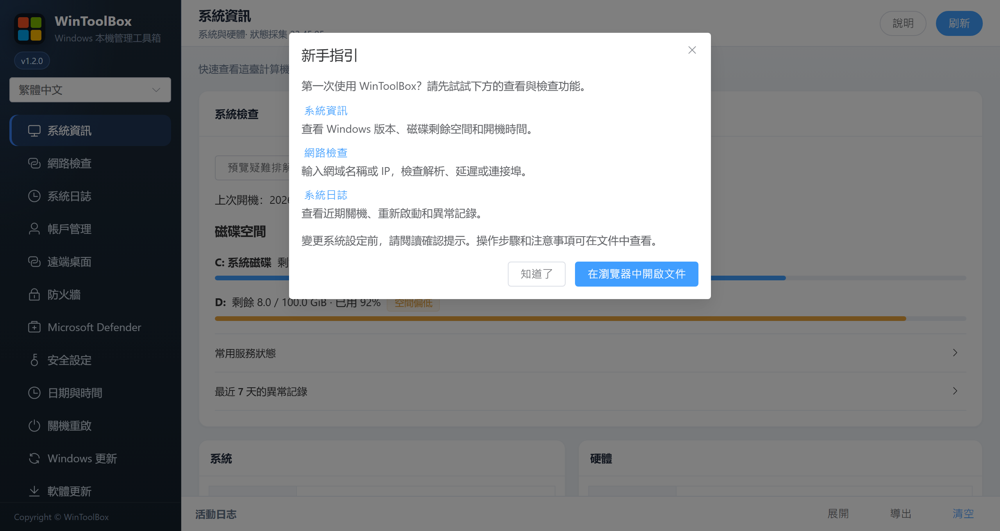

[English](../README.md) · [繁體中文](../zh-Hant/README.md) · [简体中文](../zh-Hans/README.md)

# WinToolBox 文件

第一次開啟新版時，會顯示 **新手指引**，可直接前往系統資訊、網路檢查或系統日誌。之後按頂部 **說明** 可再次查看。按 **在瀏覽器中開啟文件**，會開啟目前語言的線上文件。

截圖使用目前應用程式的繁體中文介面和範例資料。圖中的編號對應操作說明。

## 通用操作

- 左上角可切換繁體中文、简体中文或 English，選擇會自動保存。頂部 **說明** 可再次開啟新手指引，並前往目前語言的線上文件。
- **刷新** 會重新讀取目前頁面。在 **系統日誌** 中會重新讀取日誌報告，在 **軟體更新** 中也會檢查新版本。**網路檢查** 請按 **開始檢查** 重新測試。
- 確認操作後，請等待執行和複查完成。**檢視日誌** 會展開活動日誌，**關閉提示** 會關閉結果提示。遇到複查不完整或失敗時，請先查看日誌並核對目前狀態，再決定是否重試。
- 底部 **活動日誌** 可 **展開** 或 **收起**。**匯出** 會將目前活動儲存為 `wintoolbox-log.txt`，分享前請先核對。**清空** 只清空活動面板，Windows 事件仍可在 **系統日誌** 查看。

## 功能文件

| 文件 | 說明 |
|------|------|
| [00 · 下載](./00-download.md) | 下載、攔截、校驗、系統管理員執行 |
| [系統資訊](./01-overview.md) | 系統與硬體資訊 |
| [網路檢查](./12-network-check.md) | DNS、Ping、TCPing、本機監聽、公網出口與 MTR |
| [系統日誌](./11-system-logs.md) | 啟停、重新啟動、異常證據與匯出 |
| [帳戶管理](./02-local-account.md) | 來賓/自動登錄、密碼策略、鎖定、改密 |
| [遠端桌面](./03-remote-desktop.md) | 連接埠、開關、NLA、連線記錄 |
| [防火牆](./04-firewall.md) | 設定檔案、放行、禁 ping、高危連接埠 |
| [Microsoft Defender](./06-defender.md) | Defender 即時防護開關 |
| [安全設定](./05-security-harden.md) | SMBv1、WinRM、匿名枚舉 |
| [日期與時間](./07-time-sync.md) | 時區、NTP、對時與測試 |
| [關機重啟](./08-power.md) | 鎖定 / 重新啟動 / 關機 / 取消 |
| [Windows 更新](./09-windows-update.md) | Windows Update 開關 |
| [軟體更新](./10-app-update.md) | 本軟體檢查、下載、安裝 |
| [90 · 系統加固指南](./90-hardening-guide.md) | 推薦順序：帳戶 → RDP → 防火牆 → 加固 → 更新 |

需**系統管理員權限**。域環境可能被組策略覆蓋。

[語言選擇](localization.md)

[操作回饋與功能審查](operation-audit-2026-10-12.md)
