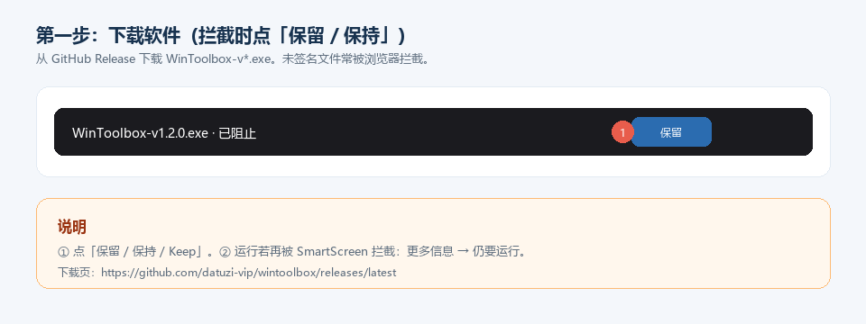
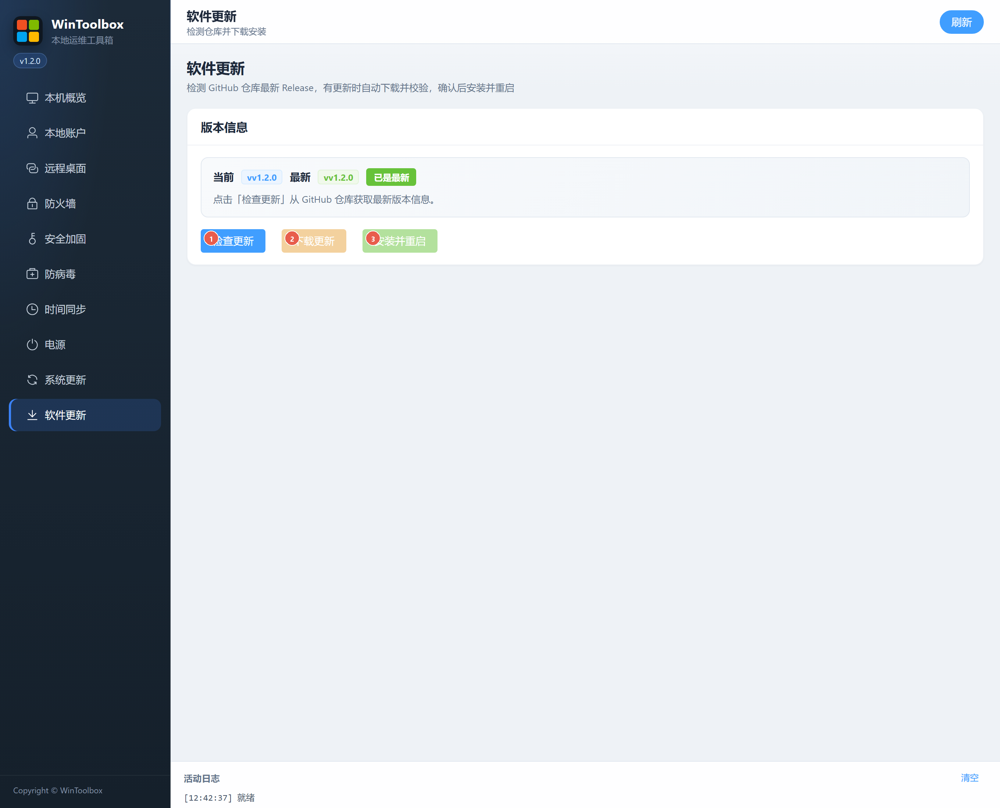

[English](../10-app-update.md) | [繁體中文](../zh-TW/10-app-update.md) | [簡體中文](../zh-CN/10-app-update.md)

# 10 · 軟體更新

檢測 GitHub 倉庫最新 Release，下載並校驗後安裝重新啟動 WinToolBox 自身。

## 第一步：下載

若尚未安裝，請先從 Release 獲取安裝包：
https://github.com/lucaswren/wintoolbox/releases/latest

攔截點 **保留 / 保持**。詳：[00 · 下載](./00-download.md)

## 介面標注

| # | 按鈕 | 說明 |
|---|------|------|
| ① | **檢查更新** | 從 GitHub 拉取最新版本資訊 |
| ② | **下載更新** | 有新版本時下載安裝包並校驗 |
| ③ | **安裝並重新啟動** | 校驗通過後替換並重新啟動應用 |

頁面會顯示當前 / 最新版本、是否有更新、SHA256 與本地路徑等資訊。

## 步驟

1. **軟體更新** → **檢查更新**
2. 若提示有更新 → **下載更新**（等待校驗成功）
3. **安裝並重新啟動**

需能訪問 GitHub（或你設定的 Release 源）。網路失敗時查看活動日志中的錯誤資訊。

相關：[文件首頁](./README.md) · [00 · 下載](./00-download.md)
